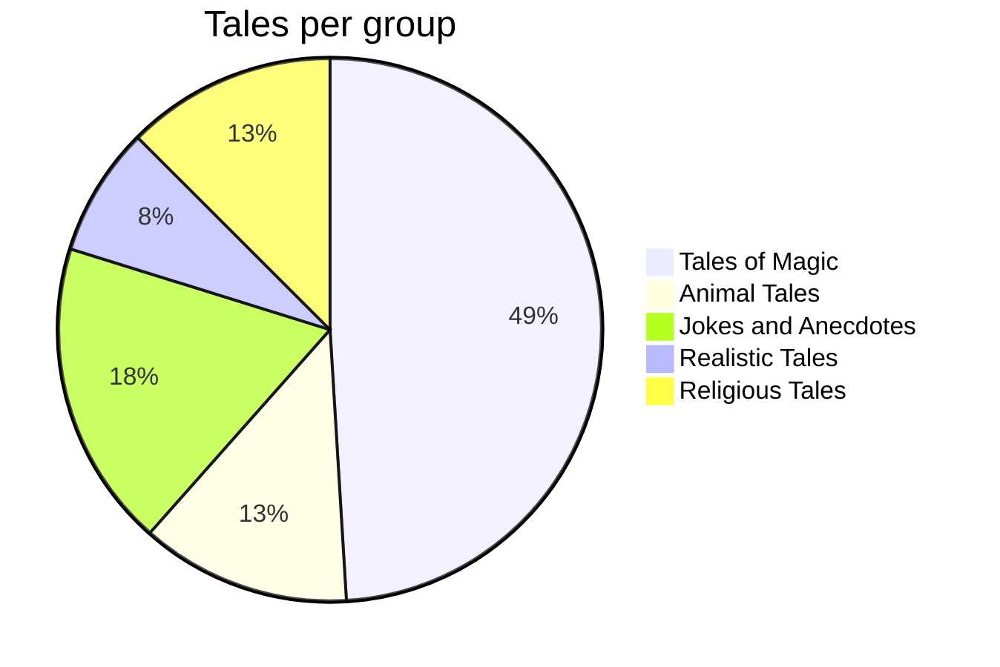

---
tags:
  - grimm
  - index
---

# Grimm's Household Tales

198 tales and 10 children's legends of the *Kinder- und Hausmärchen* (final edition, 1857), in the English translation by **Margaret Hunt** (1884). Both are in the public domain.

> [!note] Not included
> 3 tales of the collection are left out because of their antisemitic content. The complete text is available from Project Gutenberg (eBook #5314).

> [!note] About the folders
> The tales are grouped loosely after the main groups of the Aarne–Thompson–Uther index. The grouping was made by hand for this demo and is not an authoritative classification.

## Groups

- [[Animal Tales]]
- [[Tales of Magic]]
  - [[Supernatural Adversaries]]
  - [[Enchanted Spouses and Siblings]]
  - [[Superhuman Tasks]]
  - [[Supernatural Helpers]]
  - [[Magic Objects]]
  - [[Supernatural Power or Knowledge]]
  - [[Other Tales of the Supernatural]]
- [[Religious Tales]]
  - [[Children's Legends]]
- [[Realistic Tales]]
- [[Jokes and Anecdotes]]

## More to Explore

- [[Best-Known Tales]] — the famous ones, with story flowcharts and dialogues
- [[Characters]] — who appears where, grouped by kind and rank
- [[Statistics]] — charts about the tales and their characters
- [[Places and Things]] — forests, castles, wells, and magic objects
- [[All Characters]] — one very wide table for print and PDF tests

The best-known tales also have a flowchart of the story, a dialogue as a sequence diagram and a chart of who is related to whom: [[The Frog-King, or Iron Henry]], [[Hansel and Grethel]], [[Little Red-Cap]], [[Little Snow-white]], [[Cinderella]], [[Rapunzel]], [[Rumpelstiltskin]], [[Briar-Rose]], [[The Bremen Town-Musicians]], [[Mother Holle]], [[The Fisherman and His Wife]], [[The Wolf and the Seven Little Kids]], [[The Valiant Little Tailor]].

## All tales

| No. | Title | German title | Group |
|----:|-------|--------------|-------|
| 1 | [[The Frog-King, or Iron Henry]] | Der Froschkönig oder der eiserne Heinrich | Enchanted Spouses and Siblings |
| 2 | [[Cat and Mouse in Partnership]] | Katze und Maus in Gesellschaft | Animal Tales |
| 3 | [[Our Lady's Child]] | Marienkind | Other Tales of the Supernatural |
| 4 | [[The Story of the Youth Who Went Forth to Learn What Fear Was]] | Märchen von einem, der auszog, das Fürchten zu lernen | Supernatural Adversaries |
| 5 | [[The Wolf and the Seven Little Kids]] | Der Wolf und die sieben jungen Geißlein | Animal Tales |
| 6 | [[Faithful John]] | Der treue Johannes | Supernatural Helpers |
| 8 | [[The Wonderful Musician]] | Der wunderliche Spielmann | Animal Tales |
| 9 | [[The Twelve Brothers]] | Die zwölf Brüder | Enchanted Spouses and Siblings |
| 10 | [[The Pack of Ragamuffins]] | Das Lumpengesindel | Animal Tales |
| 11 | [[Little Brother and Little Sister]] | Brüderchen und Schwesterchen | Enchanted Spouses and Siblings |
| 12 | [[Rapunzel]] | Rapunzel | Supernatural Adversaries |
| 13 | [[The Three Little Men in the Wood]] | Die drei Männlein im Walde | Enchanted Spouses and Siblings |
| 14 | [[The Three Spinners]] | Die drei Spinnerinnen | Supernatural Helpers |
| 15 | [[Hansel and Grethel]] | Hänsel und Gretel | Supernatural Adversaries |
| 16 | [[The Three Snake-Leaves]] | Die drei Schlangenblätter | Magic Objects |
| 17 | [[The White Snake]] | Die weiße Schlange | Supernatural Power or Knowledge |
| 18 | [[The Straw, the Coal, and the Bean]] | Strohhalm, Kohle und Bohne | Animal Tales |
| 19 | [[The Fisherman and His Wife]] | Von dem Fischer un syner Fru | Supernatural Helpers |
| 20 | [[The Valiant Little Tailor]] | Das tapfere Schneiderlein | Jokes and Anecdotes |
| 21 | [[Cinderella]] | Aschenputtel | Supernatural Helpers |
| 22 | [[The Riddle]] | Das Rätsel | Realistic Tales |
| 23 | [[The Mouse, the Bird, and the Sausage]] | Von dem Mäuschen, Vögelchen und der Bratwurst | Animal Tales |
| 24 | [[Mother Holle]] | Frau Holle | Superhuman Tasks |
| 25 | [[The Seven Ravens]] | Die sieben Raben | Enchanted Spouses and Siblings |
| 26 | [[Little Red-Cap]] | Rotkäppchen | Supernatural Adversaries |
| 27 | [[The Bremen Town-Musicians]] | Die Bremer Stadtmusikanten | Animal Tales |
| 28 | [[The Singing Bone]] | Der singende Knochen | Religious Tales |
| 29 | [[The Devil With the Three Golden Hairs]] | Der Teufel mit den drei goldenen Haaren | Superhuman Tasks |
| 30 | [[The Louse and the Flea]] | Läuschen und Flöhchen | Jokes and Anecdotes |
| 31 | [[The Girl Without Hands]] | Das Mädchen ohne Hände | Other Tales of the Supernatural |
| 32 | [[Clever Hans]] | Der gescheite Hans | Jokes and Anecdotes |
| 33 | [[The Three Languages]] | Die drei Sprachen | Supernatural Power or Knowledge |
| 34 | [[Clever Elsie]] | Die kluge Else | Jokes and Anecdotes |
| 35 | [[The Tailor in Heaven]] | Der Schneider im Himmel | Religious Tales |
| 36 | [[The Wishing-Table, the Gold-Ass, and the Cudgel in the Sack]] | Tischchendeckdich, Goldesel und Knüppel aus dem Sack | Magic Objects |
| 37 | [[Thumbling]] | Daumesdick | Other Tales of the Supernatural |
| 38 | [[The Wedding of Mrs. Fox]] | Die Hochzeit der Frau Füchsin | Animal Tales |
| 39 | [[The Elves]] | Die Wichtelmänner | Supernatural Helpers |
| 40 | [[The Robber Bridegroom]] | Der Räuberbräutigam | Realistic Tales |
| 41 | [[Herr Korbes]] | Herr Korbes | Animal Tales |
| 42 | [[The Godfather]] | Der Herr Gevatter | Supernatural Adversaries |
| 43 | [[Frau Trude]] | Frau Trude | Supernatural Adversaries |
| 44 | [[Godfather Death]] | Der Gevatter Tod | Supernatural Adversaries |
| 45 | [[Thumbling as Journeyman]] | Daumerlings Wanderschaft | Other Tales of the Supernatural |
| 46 | [[Fitcher's Bird]] | Fitchers Vogel | Supernatural Adversaries |
| 47 | [[The Juniper-Tree]] | Von dem Machandelboom | Other Tales of the Supernatural |
| 48 | [[Old Sultan]] | Der alte Sultan | Animal Tales |
| 49 | [[The Six Swans]] | Die sechs Schwäne | Enchanted Spouses and Siblings |
| 50 | [[Briar-Rose]] | Dornröschen | Enchanted Spouses and Siblings |
| 51 | [[Fundevogel (Bird-foundling)]] | Fundevogel | Supernatural Adversaries |
| 52 | [[King Thrushbeard]] | König Drosselbart | Realistic Tales |
| 53 | [[Little Snow-white]] | Sneewittchen | Other Tales of the Supernatural |
| 54 | [[The Knapsack, the Hat, and the Horn]] | Der Ranzen, das Hütlein und das Hörnlein | Magic Objects |
| 55 | [[Rumpelstiltskin]] | Rumpelstilzchen | Supernatural Helpers |
| 56 | [[Sweetheart Roland]] | Der Liebste Roland | Supernatural Adversaries |
| 57 | [[The Golden Bird]] | Der goldene Vogel | Supernatural Helpers |
| 58 | [[The Dog and the Sparrow]] | Der Hund und der Sperling | Animal Tales |
| 59 | [[Frederick and Catherine]] | Der Frieder und das Catherlieschen | Jokes and Anecdotes |
| 60 | [[The Two Brothers]] | Die zwei Brüder | Supernatural Adversaries |
| 61 | [[The Little Peasant]] | Das Bürle | Jokes and Anecdotes |
| 62 | [[The Queen Bee]] | Die Bienenkönigin | Supernatural Helpers |
| 63 | [[The Three Feathers]] | Die drei Federn | Enchanted Spouses and Siblings |
| 64 | [[The Golden Goose]] | Die goldene Gans | Magic Objects |
| 65 | [[Allerleirauh]] | Allerleirauh | Supernatural Helpers |
| 66 | [[The Hare's Bride]] | Häsichenbraut | Supernatural Adversaries |
| 67 | [[The Twelve Huntsmen]] | Die zwölf Jäger | Realistic Tales |
| 68 | [[The Thief and his Master]] | De Gaudeif un sien Meester | Supernatural Adversaries |
| 69 | [[Jorinda and Joringel]] | Jorinde und Joringel | Enchanted Spouses and Siblings |
| 70 | [[The Three Sons of Fortune]] | Die drei Glückskinder | Jokes and Anecdotes |
| 71 | [[How Six Men Got on in the World]] | Sechse kommen durch die ganze Welt | Supernatural Helpers |
| 72 | [[The Wolf and the Man]] | Der Wolf und der Mensch | Animal Tales |
| 73 | [[The Wolf and the Fox]] | Der Wolf und der Fuchs | Animal Tales |
| 74 | [[The Fox and His Cousin]] | Der Fuchs und die Frau Gevatterin | Animal Tales |
| 75 | [[The Fox and the Cat]] | Der Fuchs und die Katze | Animal Tales |
| 76 | [[The Pink]] | Die Nelke | Supernatural Power or Knowledge |
| 77 | [[Clever Grethel]] | Das kluge Gretel | Jokes and Anecdotes |
| 78 | [[The Old Man and His Grandson]] | Der alte Großvater und der Enkel | Realistic Tales |
| 79 | [[The Water-Nix]] | Die Wassernixe | Supernatural Adversaries |
| 80 | [[The Death of the Little Hen]] | Von dem Tode des Hühnchens | Jokes and Anecdotes |
| 81 | [[Brother Lustig]] | Bruder Lustig | Religious Tales |
| 82 | [[Gambling Hansel]] | De Spielhansl | Supernatural Adversaries |
| 83 | [[Hans in Luck]] | Hans im Glück | Jokes and Anecdotes |
| 84 | [[Hans Married]] | Hans heiratet | Jokes and Anecdotes |
| 85 | [[The Gold-Children]] | Die Goldkinder | Supernatural Adversaries |
| 86 | [[The Fox and the Geese]] | Der Fuchs und die Gänse | Animal Tales |
| 87 | [[The Poor Man and the Rich Man]] | Der Arme und der Reiche | Religious Tales |
| 88 | [[The Singing, Springing Lark]] | Das singende springende Löweneckerchen | Enchanted Spouses and Siblings |
| 89 | [[The Goose-Girl]] | Die Gänsemagd | Supernatural Helpers |
| 90 | [[The Young Giant]] | Der junge Riese | Supernatural Power or Knowledge |
| 91 | [[The Gnome]] | Dat Erdmänneken | Supernatural Adversaries |
| 92 | [[The King of the Golden Mountain]] | Der König vom goldenen Berg | Enchanted Spouses and Siblings |
| 93 | [[The Raven]] | Die Rabe | Enchanted Spouses and Siblings |
| 94 | [[The Peasant's Wise Daughter]] | Die kluge Bauerntochter | Realistic Tales |
| 95 | [[Old Hildebrand]] | Der alte Hildebrand | Jokes and Anecdotes |
| 96 | [[The Three Little Birds]] | De drei Vügelkens | Other Tales of the Supernatural |
| 97 | [[The Water of Life]] | Das Wasser des Lebens | Supernatural Helpers |
| 98 | [[Doctor Knowall]] | Doktor Allwissend | Jokes and Anecdotes |
| 99 | [[The Spirit in the Bottle]] | Der Geist im Glas | Supernatural Adversaries |
| 100 | [[The Devil's Sooty Brother]] | Des Teufels rußiger Bruder | Superhuman Tasks |
| 101 | [[Bearskin]] | Der Bärenhäuter | Supernatural Adversaries |
| 102 | [[The Willow-Wren and the Bear]] | Der Zaunkönig und der Bär | Animal Tales |
| 103 | [[Sweet Porridge]] | Der süße Brei | Magic Objects |
| 104 | [[Wise Folks]] | Die klugen Leute | Jokes and Anecdotes |
| 105 | [[Stories about Snakes]] | Märchen von der Unke | Animal Tales |
| 106 | [[The Poor Miller's Boy and the Cat]] | Der arme Müllerbursch und das Kätzchen | Enchanted Spouses and Siblings |
| 107 | [[The Two Travellers]] | Die beiden Wanderer | Magic Objects |
| 108 | [[Hans the Hedgehog]] | Hans mein Igel | Enchanted Spouses and Siblings |
| 109 | [[The Shroud]] | Das Totenhemdchen | Religious Tales |
| 111 | [[The Skilful Huntsman]] | Der gelernte Jäger | Supernatural Adversaries |
| 112 | [[The Flail From Heaven]] | Der Dreschflegel vom Himmel | Jokes and Anecdotes |
| 113 | [[The Two Kings' Children]] | De beiden Künigeskinner | Supernatural Adversaries |
| 114 | [[The Cunning Little Tailor]] | Vom klugen Schneiderlein | Realistic Tales |
| 116 | [[The Blue Light]] | Das blaue Licht | Magic Objects |
| 117 | [[The Wilful Child]] | Das eigensinnige Kind | Religious Tales |
| 118 | [[The Three Army-Surgeons]] | Die drei Feldscherer | Supernatural Power or Knowledge |
| 119 | [[The Seven Swabians]] | Die sieben Schwaben | Jokes and Anecdotes |
| 120 | [[The Three Apprentices]] | Die drei Handwerksburschen | Supernatural Adversaries |
| 121 | [[The King's Son Who Feared Nothing]] | Der Königssohn, der sich vor nichts fürchtet | Magic Objects |
| 122 | [[Donkey Cabbages]] | Der Krautesel | Magic Objects |
| 123 | [[The Old Woman in the Wood]] | Die Alte im Wald | Enchanted Spouses and Siblings |
| 124 | [[The Three Brothers]] | Die drei Brüder | Supernatural Power or Knowledge |
| 125 | [[The Devil and his Grandmother]] | Der Teufel und seine Großmutter | Religious Tales |
| 126 | [[Ferdinand the Faithful]] | Ferenand getrü un Ferenand ungetrü | Supernatural Helpers |
| 127 | [[The Iron Stove]] | Der Eisenofen | Enchanted Spouses and Siblings |
| 128 | [[The Lazy Spinner]] | Die faule Spinnerin | Jokes and Anecdotes |
| 129 | [[The Four Skilful Brothers]] | Die vier kunstreichen Brüder | Supernatural Power or Knowledge |
| 130 | [[One-eye, Two-eyes, and Three-eyes]] | Einäuglein, Zweiäuglein und Dreiäuglein | Supernatural Helpers |
| 131 | [[Fair Katrinelje and Pif-Paf-Poltrie]] | Die schöne Katrinelje und Pif Paf Poltrie | Jokes and Anecdotes |
| 132 | [[The Fox and the Horse]] | Der Fuchs und das Pferd | Animal Tales |
| 133 | [[The Shoes That Were Danced to Pieces]] | Die zertanzten Schuhe | Supernatural Adversaries |
| 134 | [[The Six Servants]] | Die sechs Diener | Supernatural Helpers |
| 135 | [[The White Bride and the Black One]] | Die weiße und die schwarze Braut | Enchanted Spouses and Siblings |
| 136 | [[Iron John]] | Der Eisenhans | Supernatural Helpers |
| 137 | [[The Three Black Princesses]] | De drei schwatten Prinzessinnen | Enchanted Spouses and Siblings |
| 138 | [[Knoist and his Three Sons]] | Knoist un sine dre Sühne | Jokes and Anecdotes |
| 139 | [[The Maid of Brakel]] | Dat Mäken von Brakel | Jokes and Anecdotes |
| 140 | [[Domestic Servants]] | Das Hausgesinde | Jokes and Anecdotes |
| 141 | [[The Lambkin and the Little Fish]] | Das Lämmchen und Fischchen | Enchanted Spouses and Siblings |
| 142 | [[Simeli Mountain]] | Simeliberg | Supernatural Power or Knowledge |
| 143 | [[Going A-Travelling]] | Up Reisen gohn | Jokes and Anecdotes |
| 144 | [[The Donkey]] | Das Eselein | Enchanted Spouses and Siblings |
| 145 | [[The Ungrateful Son]] | Der undankbare Sohn | Realistic Tales |
| 146 | [[The Turnip]] | Die Rübe | Jokes and Anecdotes |
| 147 | [[The Old Man Made Young Again]] | Das junggeglühte Männlein | Religious Tales |
| 148 | [[The Lord's Animals and the Devil's]] | Des Herrn und des Teufels Getier | Religious Tales |
| 149 | [[The Beam]] | Der Hahnenbalken | Realistic Tales |
| 150 | [[The Old Beggar-Woman]] | Die alte Bettelfrau | Realistic Tales |
| 151 | [[The Three Sluggards]] | Die drei Faulen | Jokes and Anecdotes |
| 151* | [[The Twelve Idle Servants]] | Die zwölf faulen Knechte | Jokes and Anecdotes |
| 152 | [[The Shepherd Boy]] | Das Hirtenbüblein | Realistic Tales |
| 153 | [[The Star-Money]] | Die Sterntaler | Religious Tales |
| 154 | [[The Stolen Farthings]] | Der gestohlene Heller | Religious Tales |
| 155 | [[Brides On Their Trial]] | Die Brautschau | Jokes and Anecdotes |
| 156 | [[Odds And Ends]] | Die Schlickerlinge | Jokes and Anecdotes |
| 157 | [[The Sparrow And His Four Children]] | Der Sperling und seine vier Kinder | Animal Tales |
| 158 | [[The Story of Schlauraffen Land]] | Das Märchen vom Schlauraffenland | Jokes and Anecdotes |
| 159 | [[The Ditmarsch Tale of Wonders]] | Das Diethmarsische Lügenmärchen | Jokes and Anecdotes |
| 160 | [[A Riddling Tale]] | Rätselmärchen | Enchanted Spouses and Siblings |
| 161 | [[Snow-White and Rose-Red]] | Schneeweißchen und Rosenrot | Enchanted Spouses and Siblings |
| 162 | [[The Wise Servant]] | Der kluge Knecht | Jokes and Anecdotes |
| 163 | [[The Glass Coffin]] | Der gläserne Sarg | Enchanted Spouses and Siblings |
| 164 | [[Lazy Harry]] | Der faule Heinz | Jokes and Anecdotes |
| 165 | [[The Griffin]] | Der Vogel Greif | Superhuman Tasks |
| 166 | [[Strong Hans]] | Der starke Hans | Supernatural Power or Knowledge |
| 167 | [[The Peasant in Heaven]] | Das Bürle im Himmel | Religious Tales |
| 168 | [[Lean Lisa]] | Die hagere Liese | Jokes and Anecdotes |
| 169 | [[The Hut in the Forest]] | Das Waldhaus | Enchanted Spouses and Siblings |
| 170 | [[Sharing Joy and Sorrow]] | Lieb und Leid teilen | Realistic Tales |
| 171 | [[The Willow-Wren]] | Der Zaunkönig | Animal Tales |
| 172 | [[The Sole]] | Die Scholle | Animal Tales |
| 173 | [[The Bittern and the Hoopoe]] | Rohrdommel und Wiedehopf | Animal Tales |
| 174 | [[The Owl]] | Die Eule | Jokes and Anecdotes |
| 175 | [[The Moon]] | Der Mond | Other Tales of the Supernatural |
| 176 | [[The Duration of Life]] | Die Lebenszeit | Animal Tales |
| 177 | [[Death's Messengers]] | Die Boten des Todes | Supernatural Adversaries |
| 178 | [[Master Pfriem (Master Cobbler's Awl)]] | Meister Pfriem | Religious Tales |
| 179 | [[The Goose-Girl at the Well]] | Die Gänsehirtin am Brunnen | Realistic Tales |
| 180 | [[Eve's Various Children]] | Die ungleichen Kinder Evas | Religious Tales |
| 181 | [[The Nix of the Mill-Pond]] | Die Nixe im Teich | Supernatural Adversaries |
| 182 | [[The Little Folks' Presents]] | Die Geschenke des kleinen Volkes | Supernatural Helpers |
| 183 | [[The Giant and the Tailor]] | Der Riese und der Schneider | Jokes and Anecdotes |
| 184 | [[The Nail]] | Der Nagel | Jokes and Anecdotes |
| 185 | [[The Poor Boy in the Grave]] | Der arme Junge im Grab | Realistic Tales |
| 186 | [[The True Sweethearts]] | Die wahre Braut | Supernatural Helpers |
| 187 | [[The Hare and the Hedgehog]] | Der Hase und der Igel | Animal Tales |
| 188 | [[The Spindle, The Shuttle, and the Needle]] | Spindel, Weberschiffchen und Nadel | Magic Objects |
| 189 | [[The Peasant and the Devil]] | Der Bauer und der Teufel | Jokes and Anecdotes |
| 190 | [[The Crumbs on the Table]] | Die Brosamen auf dem Tisch | Animal Tales |
| 191 | [[The Sea-Hare]] | Das Meerhäschen | Supernatural Adversaries |
| 192 | [[The Master-Thief]] | Der Meisterdieb | Jokes and Anecdotes |
| 193 | [[The Drummer]] | Der Trommler | Enchanted Spouses and Siblings |
| 194 | [[The Ear of Corn]] | Die Kornähre | Religious Tales |
| 195 | [[The Grave-Mound]] | Der Grabhügel | Religious Tales |
| 196 | [[Old Rinkrank]] | Oll Rinkrank | Supernatural Adversaries |
| 197 | [[The Crystal Ball]] | Die Kristallkugel | Supernatural Helpers |
| 198 | [[Maid Maleen]] | Jungfrau Maleen | Realistic Tales |
| 199 | [[The Boots of Buffalo-Leather]] | Der Stiefel von Büffelleder | Realistic Tales |
| 200 | [[The Golden Key]] | Der goldene Schlüssel | Jokes and Anecdotes |
| Legend 1 | [[St. Joseph in the Forest]] | Der heilige Joseph im Walde | Children's Legends |
| Legend 2 | [[The Twelve Apostles]] | Die zwölf Apostel | Children's Legends |
| Legend 3 | [[The Rose]] | Die Rose | Children's Legends |
| Legend 4 | [[Poverty and Humility Lead to Heaven]] | Armut und Demut führen zum Himmel | Children's Legends |
| Legend 5 | [[God's Food]] | Gottes Speise | Children's Legends |
| Legend 6 | [[The Three Green Twigs]] | Die drei grünen Zweige | Children's Legends |
| Legend 7 | [[Our Lady's Little Glass]] | Muttergottesgläschen | Children's Legends |
| Legend 8 | [[The Aged Mother]] | Die alte Mütterchen | Children's Legends |
| Legend 9 | [[The Heavenly Wedding]] | Die himmlische Hochzeit | Children's Legends |
| Legend 10 | [[The Hazel-Branch]] | Die Haselrute | Children's Legends |
