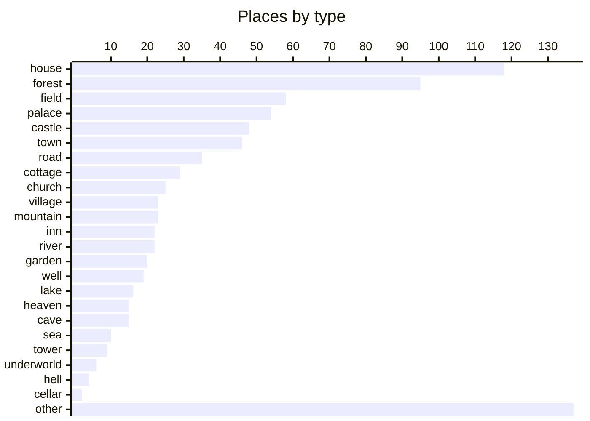

---
tags:
  - grimm
  - index
---

# Places and Things

Where the tales happen and the magic objects in them. Back to the [[Grimm's Household Tales|index]].

## Places

### House

- [[Cat and Mouse in Partnership]]: the house the two share
- [[The Wolf and the Seven Little Kids]]: house
- [[The Three Little Men in the Wood]]: the little men's house; the stepmother's house
- [[The Three Spinners]]: the girl's house
- [[Hansel and Grethel]]: the house of bread and cake; the witch's stable
- [[The Straw, the Coal, and the Bean]]: the old woman's hearth
- [[The Valiant Little Tailor]]: tailor's workshop
- [[Cinderella]]: the father's house and kitchen
- [[The Mouse, the Bird, and the Sausage]]: the house (kitchen and hearth)
- [[Mother Holle]]: stepmother's house
- [[The Seven Ravens]]: the parents' house
- [[The Bremen Town-Musicians]]: the robbers' house
- [[The Devil With the Three Golden Hairs]]: mill
- [[The Louse and the Flea]]: the house of the louse and flea
- [[The Girl Without Hands]]: the mill
- [[Clever Hans]]: Grethel's house; Hans's home
- [[Clever Elsie]]: house
- [[The Wishing-Table, the Gold-Ass, and the Cudgel in the Sack]]: the tailor's house
- [[Thumbling]]: pastor's house
- [[The Wedding of Mrs. Fox]]: Mrs. Fox's house
- [[The Elves]]: house; hearth
- [[The Robber Bridegroom]]: robbers' house
- [[Herr Korbes]]: house of Herr Korbes
- [[The Godfather]]: godfather's house; stairs
- [[Frau Trude]]: Frau Trude's house
- [[Thumbling as Journeyman]]: parents' house; master tailor's workshop
- [[Fitcher's Bird]]: father's house
- [[The Juniper-Tree]]: father's house; goldsmith's house
- [[Fundevogel (Bird-foundling)]]: forester's house
- [[The Knapsack, the Hat, and the Horn]]: the brothers' house
- [[Sweetheart Roland]]: the witch's house; the shepherd's house
- [[The Dog and the Sparrow]]: the waggoner's house
- [[Frederick and Catherine]]: the house and its cellar
- [[The Little Peasant]]: the little peasant's house
- [[The Golden Goose]]: the father's house
- [[The Hare's Bride]]: the hare's hut
- [[The Thief and his Master]]: the little house in the forest
- [[The Wolf and the Fox]]: farmhouse
- [[The Fox and His Cousin]]: the she-wolf's house
- [[Clever Grethel]]: kitchen
- [[The Old Man and His Grandson]]: the family house (corner behind the stove and the table)
- [[Brother Lustig]]: peasant's house
- [[Gambling Hansel]]: gaming house
- [[Hans Married]]: Hans's house and fields (the bridegroom's property)
- [[The Poor Man and the Rich Man]]: the rich man’s house
- [[The Singing, Springing Lark]]: father's house
- [[The Raven]]: the house with the old woman and the tan heap garden; the giant's small house
- [[The Peasant's Wise Daughter]]: the peasant's small house
- [[Old Hildebrand]]: peasant's house
- [[The Spirit in the Bottle]]: the woodcutter's home
- [[Bearskin]]: bride's house
- [[Sweet Porridge]]: the family house
- [[Wise Folks]]: house and byre
- [[The Poor Miller's Boy and the Cat]]: the silver house
- [[The Two Travellers]]: stone house
- [[Hans the Hedgehog]]: the countryman’s house
- [[The Shroud]]: the mother's house
- [[The Blue Light]]: the witch's house and garden
- [[The Three Apprentices]]: innkeeper's cellar
- [[The King's Son Who Feared Nothing]]: giant's house
- [[The Old Woman in the Wood]]: the old woman's little house; the room of rings
- [[The Three Brothers]]: the house (the father's)
- [[The Devil and his Grandmother]]: rock-house (fallen rock shaped like a little house)
- [[The Lazy Spinner]]: house (parlour, loft and kitchen)
- [[The Four Skilful Brothers]]: the father's house
- [[One-eye, Two-eyes, and Three-eyes]]: family house with the front door
- [[Fair Katrinelje and Pif-Paf-Poltrie]]: house (room); cow-house
- [[The Fox and the Horse]]: master's stable
- [[The White Bride and the Black One]]: kitchen
- [[The Lambkin and the Little Fish]]: kitchen
- [[The Ungrateful Son]]: door of the house
- [[The Old Man Made Young Again]]: the smith's house
- [[The Old Beggar-Woman]]: door of a house; fireplace by the house
- [[The Stolen Farthings]]: dining room; next room (with floorboards)
- [[The Sparrow And His Four Children]]: stable
- [[A Riddling Tale]]: her home
- [[Lazy Harry]]: Harry's house and bedroom
- [[The Griffin]]: the Griffin's house
- [[Lean Lisa]]: marital bed in the house
- [[The Hut in the Forest]]: cellar
- [[Sharing Joy and Sorrow]]: house
- [[Master Pfriem (Master Cobbler's Awl)]]: Pfriem's workshop; the new house being built
- [[The Goose-Girl at the Well]]: the old woman's house
- [[Eve's Various Children]]: house
- [[The Nix of the Mill-Pond]]: the wise woman's cottage on the mountain
- [[The Nail]]: his own house
- [[The Poor Boy in the Grave]]: farmer's house; judge's house
- [[The Hare and the Hedgehog]]: the hedgehog's house
- [[The Spindle, The Shuttle, and the Needle]]: small house at the end of the village
- [[The Crumbs on the Table]]: the parlour
- [[The Master-Thief]]: stable; pigeon-house
- [[The Drummer]]: stone house on the glass-mountain
- [[The Grave-Mound]]: rich farmer's house and sitting-room
- [[Old Rinkrank]]: Old Rinkrank’s house
- [[Maid Maleen]]: kitchen
- [[The Boots of Buffalo-Leather]]: robbers' stone house
- [[The Rose]]: the mother's house
- [[Poverty and Humility Lead to Heaven]]: place under the stairs
- [[God's Food]]: the rich sister's house; the widow's room
- [[The Aged Mother]]: old woman's room
- [[The Hazel-Branch]]: house (cradle)

### Forest

- [[The Frog-King, or Iron Henry]]: dark forest with a well under an old lime-tree
- [[Our Lady's Child]]: the great forest by the wood-cutter's house; the wilderness with the hollow tree
- [[The Wolf and the Seven Little Kids]]: forest
- [[The Wonderful Musician]]: the forest
- [[The Twelve Brothers]]: forest
- [[Little Brother and Little Sister]]: the forest
- [[Rapunzel]]: the forest
- [[The Three Little Men in the Wood]]: the wood (winter forest)
- [[Hansel and Grethel]]: great forest
- [[The White Snake]]: the wood
- [[The Valiant Little Tailor]]: forest
- [[The Riddle]]: the great forest
- [[The Mouse, the Bird, and the Sausage]]: the wood
- [[Little Red-Cap]]: the wood
- [[The Bremen Town-Musicians]]: the forest
- [[The Singing Bone]]: the forest
- [[The Devil With the Three Golden Hairs]]: forest
- [[The Girl Without Hands]]: the forest
- [[Thumbling]]: forest
- [[The Robber Bridegroom]]: dark forest
- [[Thumbling as Journeyman]]: forest
- [[Fitcher's Bird]]: wizard's house in the dark forest
- [[Old Sultan]]: forest
- [[The Six Swans]]: forest
- [[Fundevogel (Bird-foundling)]]: forest
- [[King Thrushbeard]]: large forest of King Thrushbeard
- [[Little Snow-white]]: forest
- [[The Knapsack, the Hat, and the Horn]]: silver and gold hills in the forest; lonely wood of the charcoal-burners
- [[Rumpelstiltskin]]: the forest
- [[The Golden Bird]]: forest
- [[Frederick and Catherine]]: the forest
- [[The Two Brothers]]: the forest of the dragon's split route; the enchanted forest
- [[The Queen Bee]]: the bee's tree in the forest
- [[The Golden Goose]]: the forest
- [[Allerleirauh]]: forest with a hollow tree
- [[The Thief and his Master]]: the great forest
- [[Jorinda and Joringel]]: forest
- [[How Six Men Got on in the World]]: forest
- [[The Wolf and the Fox]]: forest
- [[The Fox and His Cousin]]: the edge of the forest
- [[The Fox and the Cat]]: forest
- [[The Pink]]: forest where the deer were driven
- [[Brother Lustig]]: wood
- [[The Gold-Children]]: great forest
- [[The Singing, Springing Lark]]: forest with the enchanted castle
- [[The Young Giant]]: the forest
- [[The King of the Golden Mountain]]: forest
- [[The Raven]]: the dark forest
- [[The Water of Life]]: forest
- [[The Spirit in the Bottle]]: the forest with the great oak
- [[The Devil's Sooty Brother]]: the forest
- [[The Willow-Wren and the Bear]]: forest
- [[Sweet Porridge]]: the forest
- [[The Poor Miller's Boy and the Cat]]: the forest
- [[The Two Travellers]]: great forest
- [[Hans the Hedgehog]]: the forest
- [[The Skilful Huntsman]]: the large forest
- [[The Two Kings' Children]]: forest
- [[The Blue Light]]: the forest
- [[Donkey Cabbages]]: the forest
- [[The Old Woman in the Wood]]: the dark forest; the great tree with the golden-key doors
- [[The Devil and his Grandmother]]: dark forest
- [[The Iron Stove]]: the great wild forest
- [[The Lazy Spinner]]: forest
- [[The Fox and the Horse]]: forest
- [[The Shoes That Were Danced to Pieces]]: the avenues of silver, gold and diamond trees
- [[Iron John]]: dark forest
- [[The Three Black Princesses]]: forest on a high mountain
- [[Knoist and his Three Sons]]: the mighty big forest
- [[The Lambkin and the Little Fish]]: great forest
- [[Simeli Mountain]]: forest path with a barrow
- [[The Turnip]]: road through the wood
- [[The Old Man Made Young Again]]: the woods
- [[The Star-Money]]: forest
- [[Snow-White and Rose-Red]]: forest
- [[The Glass Coffin]]: great forest
- [[The Griffin]]: the forest
- [[Strong Hans]]: forest
- [[The Hut in the Forest]]: lonely forest
- [[The Goose-Girl at the Well]]: the forest
- [[The Nix of the Mill-Pond]]: the forest
- [[The Giant and the Tailor]]: wild dark forest with the giant's tower
- [[The Sea-Hare]]: forest
- [[The Drummer]]: great forest with man-eaters
- [[The Crystal Ball]]: the great forest
- [[The Boots of Buffalo-Leather]]: forest
- [[St. Joseph in the Forest]]: great forest
- [[The Twelve Apostles]]: great forest
- [[The Rose]]: forest where the wood is gathered
- [[The Three Green Twigs]]: forest at the foot of a mountain
- [[The Hazel-Branch]]: wood

### Field

- [[The Wolf and the Seven Little Kids]]: green meadow
- [[The Three Snake-Leaves]]: battlefield
- [[Mother Holle]]: the beautiful meadow
- [[Clever Elsie]]: field
- [[Old Sultan]]: hay field
- [[King Thrushbeard]]: meadow
- [[Sweetheart Roland]]: the field with the red stone landmark
- [[Frederick and Catherine]]: the field where Frederick ploughs
- [[The Three Feathers]]: the field where the feather falls
- [[The Golden Goose]]: the fields
- [[Brother Lustig]]: meadow
- [[The Fox and the Geese]]: meadow
- [[The Singing, Springing Lark]]: meadow where the golden chickens are driven
- [[The Goose-Girl]]: meadow in the country
- [[The Young Giant]]: the field
- [[The King of the Golden Mountain]]: merchant's field outside the town
- [[The Peasant's Wise Daughter]]: the newly cleared field
- [[Bearskin]]: heath with a circle of trees
- [[The Willow-Wren and the Bear]]: battlefield
- [[Wise Folks]]: field
- [[The Flail From Heaven]]: the field (ploughing ground)
- [[The Seven Swabians]]: the meadow at twilight; the fallow-field
- [[The Three Brothers]]: the field where the hare runs
- [[The Devil and his Grandmother]]: cornfield; open country near the army
- [[One-eye, Two-eyes, and Three-eyes]]: pasture and field with high grass
- [[The Fox and the Horse]]: open country
- [[The Six Servants]]: the heath
- [[The White Bride and the Black One]]: unenclosed land
- [[Iron John]]: battle-field
- [[Knoist and his Three Sons]]: the field
- [[The Lambkin and the Little Fish]]: meadow
- [[The Lord's Animals and the Devil's]]: hedges and pasture
- [[The Beam]]: open space where the show is held; field of blue flax
- [[The Twelve Idle Servants]]: grass where the servants lie
- [[The Star-Money]]: open country
- [[The Sparrow And His Four Children]]: wheatfield
- [[The Ditmarsch Tale of Wonders]]: the great fields
- [[A Riddling Tale]]: field
- [[Snow-White and Rose-Red]]: heath with the rock
- [[The Wise Servant]]: large field
- [[Lazy Harry]]: the field where the goats graze
- [[The Bittern and the Hoopoe]]: rich green meadows; meadow with the bittern
- [[The Goose-Girl at the Well]]: the meadow
- [[Eve's Various Children]]: unfruitful ground
- [[The Nix of the Mill-Pond]]: the valley of the shepherds
- [[The Giant and the Tailor]]: marsh with willows
- [[The Poor Boy in the Grave]]: hedge and field
- [[The Hare and the Hedgehog]]: the turnip field with the long furrow; the Buxtehuder heath
- [[The Spindle, The Shuttle, and the Needle]]: open country
- [[The Peasant and the Devil]]: peasant's field
- [[The Ear of Corn]]: corn-field
- [[The Golden Key]]: the snowy wood or field where he gathers firewood
- [[The Hazel-Branch]]: spot with strawberries

### Palace

- [[The Story of the Youth Who Went Forth to Learn What Fear Was]]: the King's palace
- [[Faithful John]]: the King's palace; the Golden Dwelling
- [[Little Brother and Little Sister]]: the royal palace
- [[The Three Little Men in the Wood]]: the King's palace
- [[The Three Spinners]]: the palace
- [[The White Snake]]: the wise King's court
- [[The Fisherman and His Wife]]: the imperial palace
- [[The Valiant Little Tailor]]: royal palace
- [[Cinderella]]: the King's palace
- [[The Riddle]]: the princess's chamber
- [[The Singing Bone]]: the King's court
- [[The Girl Without Hands]]: the royal palace
- [[Godfather Death]]: King's palace
- [[Thumbling as Journeyman]]: treasure-chamber
- [[The Six Swans]]: royal palace
- [[King Thrushbeard]]: royal palace
- [[Little Snow-white]]: palace
- [[The Knapsack, the Hat, and the Horn]]: the royal palace
- [[Rumpelstiltskin]]: the King's palace
- [[The Two Brothers]]: the royal palace
- [[The Three Feathers]]: the King's palace hall
- [[Allerleirauh]]: royal palace
- [[The Twelve Huntsmen]]: the royal court; the ante-chamber
- [[The Three Sons of Fortune]]: the royal palace
- [[The Pink]]: palace and garden wished into being
- [[Brother Lustig]]: royal palace
- [[The Goose-Girl]]: royal palace
- [[The Gnome]]: the palace garden and palace
- [[The King of the Golden Mountain]]: palace dining-hall
- [[The Peasant's Wise Daughter]]: the King's palace
- [[The Water of Life]]: princess's palace
- [[The Two Travellers]]: royal palace
- [[Hans the Hedgehog]]: the palace
- [[The Two Kings' Children]]: palace
- [[The Cunning Little Tailor]]: the palace
- [[The Blue Light]]: the royal palace
- [[The Iron Stove]]: the King's palace
- [[The Six Servants]]: the palace of the prince's father
- [[The White Bride and the Black One]]: King's palace
- [[Iron John]]: palace
- [[The Donkey]]: royal palace of the donkey's parents; the old King's palace
- [[The Turnip]]: the King's palace
- [[The Shepherd Boy]]: the royal palace
- [[The Sparrow And His Four Children]]: court
- [[The Griffin]]: the King's palace
- [[The Hut in the Forest]]: royal palace (former hut)
- [[The Goose-Girl at the Well]]: the palace
- [[The Sea-Hare]]: palace
- [[Maid Maleen]]: royal palace
- [[The Boots of Buffalo-Leather]]: royal kitchen
- [[Poverty and Humility Lead to Heaven]]: palace (father's palace)

### Castle

- [[The Frog-King, or Iron Henry]]: the King's castle
- [[Our Lady's Child]]: the royal castle
- [[The Story of the Youth Who Went Forth to Learn What Fear Was]]: the haunted castle
- [[The Twelve Brothers]]: castle
- [[The Fisherman and His Wife]]: the stone castle
- [[The Six Swans]]: lonely castle
- [[Briar-Rose]]: royal castle
- [[The Golden Bird]]: castle with the bird; Golden Castle
- [[The Queen Bee]]: the enchanted castle with stone horses
- [[Jorinda and Joringel]]: witch's castle
- [[How Six Men Got on in the World]]: castle top
- [[Brother Lustig]]: castle
- [[The Gold-Children]]: golden castle
- [[The Singing, Springing Lark]]: enchanted castle of the lion-prince; the castle of the princess and prince
- [[The Gnome]]: the great castle with the table of hot food
- [[The King of the Golden Mountain]]: enchanted castle
- [[The Raven]]: the golden castle of Stromberg on the glass mountain
- [[The Three Little Birds]]: Keuterberg castle; high castle with the fountain and tree
- [[The Water of Life]]: enchanted castle
- [[Doctor Knowall]]: the lord's castle
- [[The Poor Miller's Boy and the Cat]]: the enchanted castle
- [[The Two Travellers]]: castle courtyard
- [[The Skilful Huntsman]]: the castle
- [[The Two Kings' Children]]: castle
- [[The King's Son Who Feared Nothing]]: enchanted castle
- [[Donkey Cabbages]]: the castle in the plain
- [[Ferdinand the Faithful]]: heath with the castle; the castle of the princess
- [[The Iron Stove]]: the prince's castle
- [[One-eye, Two-eyes, and Three-eyes]]: knight's father's castle
- [[The Shoes That Were Danced to Pieces]]: the underground castle
- [[The Three Black Princesses]]: enchanted castle
- [[The Lambkin and the Little Fish]]: castle
- [[The Glass Coffin]]: glass chest with miniature castle; count's castle
- [[The Griffin]]: first castle; second castle
- [[Strong Hans]]: old deserted castle
- [[The True Sweethearts]]: the magic castle on the plain
- [[The Spindle, The Shuttle, and the Needle]]: royal castle; treasure-chamber
- [[The Sea-Hare]]: palace cellar
- [[The Master-Thief]]: castle
- [[The Crystal Ball]]: the Castle of the Golden Sun on a high mountain
- [[Maid Maleen]]: father's castle (in ruins)

### Town

- [[Cat and Mouse in Partnership]]: the roofs of the town
- [[Faithful John]]: the town of the princess
- [[The Three Snake-Leaves]]: the town and royal court
- [[The Riddle]]: the princess's town
- [[The Bremen Town-Musicians]]: Bremen
- [[The Devil With the Three Golden Hairs]]: King's chief city
- [[The Three Languages]]: the strange town of the masters; Rome
- [[King Thrushbeard]]: large town; market place
- [[The Knapsack, the Hat, and the Horn]]: the town of the King
- [[The Dog and the Sparrow]]: the town (butcher and baker)
- [[The Two Brothers]]: the town hung with black crape
- [[The Little Peasant]]: the town (skin market)
- [[The Golden Goose]]: the city with the King's palace
- [[The Thief and his Master]]: the neighboring town and its fair
- [[How Six Men Got on in the World]]: town with the King's castle
- [[The Goose-Girl]]: town with dark gateway
- [[The King of the Golden Mountain]]: father's town
- [[Old Hildebrand]]: market
- [[The Spirit in the Bottle]]: the town and the goldsmith's shop
- [[The Devil's Sooty Brother]]: the town
- [[Bearskin]]: town
- [[Sweet Porridge]]: the town
- [[Stories about Snakes]]: the town walls
- [[The Two Travellers]]: royal city
- [[The Three Apprentices]]: town
- [[The Shoes That Were Danced to Pieces]]: the king's town
- [[The Six Servants]]: the town of the aged Queen
- [[Iron John]]: great city
- [[The Three Black Princesses]]: East India (town)
- [[The Maid of Brakel]]: Brakel
- [[The Story of Schlauraffen Land]]: Rome
- [[Snow-White and Rose-Red]]: town
- [[The Owl]]: little town
- [[The Goose-Girl at the Well]]: the royal town
- [[The Nail]]: the fair; the town where he rests
- [[The True Sweethearts]]: the town with the festival
- [[The Sea-Hare]]: town
- [[The Master-Thief]]: nearest town
- [[The Grave-Mound]]: neighbouring town
- [[Maid Maleen]]: large city
- [[The Boots of Buffalo-Leather]]: town
- [[Poverty and Humility Lead to Heaven]]: town and neighbourhood
- [[The Aged Mother]]: large town

### Road

- [[The Story of the Youth Who Went Forth to Learn What Fear Was]]: the road
- [[The Wonderful Musician]]: the footpath between high bushes
- [[The Pack of Ragamuffins]]: the road home
- [[The Mouse, the Bird, and the Sausage]]: the road
- [[The Bremen Town-Musicians]]: the road to Bremen
- [[Thumbling]]: road
- [[Herr Korbes]]: road
- [[The Godfather]]: outside the gate
- [[Godfather Death]]: highway
- [[Thumbling as Journeyman]]: road
- [[Sweetheart Roland]]: the road of the flight
- [[The Dog and the Sparrow]]: the highway
- [[Frederick and Catherine]]: the hill with the ruts
- [[How Six Men Got on in the World]]: highway
- [[The Wolf and the Man]]: the road used by huntsmen
- [[Hans in Luck]]: the road
- [[The Poor Man and the Rich Man]]: the road; the sandy road at noon
- [[Wise Folks]]: highways
- [[The Cunning Little Tailor]]: the road to church
- [[The Three Brothers]]: the road of the nobleman's coach
- [[Ferdinand the Faithful]]: road
- [[The Four Skilful Brothers]]: the crossroads outside the town
- [[Going A-Travelling]]: the road
- [[The Donkey]]: road into the world
- [[The Ungrateful Son]]: the world (roads)
- [[The Twelve Idle Servants]]: road
- [[The Sparrow And His Four Children]]: roads and highways
- [[Death's Messengers]]: great highway
- [[Master Pfriem (Master Cobbler's Awl)]]: the streets of the town
- [[The Nail]]: the road
- [[St. Joseph in the Forest]]: forest path back to the mother's house
- [[Poverty and Humility Lead to Heaven]]: the wide world (roads)
- [[Our Lady's Little Glass]]: road
- [[The Heavenly Wedding]]: the road over hill and valley

### Cottage

- [[The Twelve Brothers]]: bewitched hut
- [[Little Brother and Little Sister]]: the little house in the forest
- [[Hansel and Grethel]]: the wood-cutter's house
- [[The Fisherman and His Wife]]: the hovel; the cottage
- [[The Riddle]]: the witch's house
- [[Mother Holle]]: Mother Holle's cottage
- [[Little Red-Cap]]: the grandmother's cottage
- [[The Devil With the Three Golden Hairs]]: robbers' cottage
- [[The Girl Without Hands]]: the little house with the sign 'Here all dwell free'
- [[Thumbling]]: parents' cottage
- [[The Six Swans]]: forest hut
- [[King Thrushbeard]]: hovel
- [[Little Snow-white]]: seven dwarfs' cottage
- [[Rumpelstiltskin]]: the manikin's house on the mountain at the end of the forest
- [[The Gold-Children]]: fisherman's hovel / cottage; witch's little house
- [[The Poor Man and the Rich Man]]: the poor man’s cottage
- [[The Skilful Huntsman]]: the hut in the forest
- [[The Iron Stove]]: the little old house of the toads
- [[The Three Black Princesses]]: fisherman's hut
- [[The Lambkin and the Little Fish]]: hut
- [[Snow-White and Rose-Red]]: lonely cottage with garden
- [[The Glass Coffin]]: reed hut
- [[The Hut in the Forest]]: old man's hut
- [[The Master-Thief]]: cottage
- [[The Grave-Mound]]: poor man's cottage
- [[The Crystal Ball]]: the fisherman's hut on the shore
- [[St. Joseph in the Forest]]: St. Joseph's little hut

### Church

- [[Cat and Mouse in Partnership]]: the church, where the pot is hidden under the altar
- [[The Fisherman and His Wife]]: the papal church
- [[The Valiant Little Tailor]]: chapel
- [[Cinderella]]: the church
- [[The Singing Bone]]: the churchyard
- [[The Three Languages]]: the church in Rome
- [[The Wishing-Table, the Gold-Ass, and the Cudgel in the Sack]]: the churchyard
- [[The Two Brothers]]: the church on the dragon's hill
- [[The Thief and his Master]]: the church
- [[The Water-Nix]]: the church (where the nix goes on Sunday)
- [[Old Hildebrand]]: church (sermon)
- [[The Two Kings' Children]]: church
- [[The Cunning Little Tailor]]: the church
- [[The Six Servants]]: the church
- [[Knoist and his Three Sons]]: the chapel in the great tree
- [[The Maid of Brakel]]: St. Anne's Chapel
- [[The Lord's Animals and the Devil's]]: church in Constantinople
- [[The Beam]]: church
- [[The Sparrow And His Four Children]]: church
- [[The Poor Boy in the Grave]]: churchyard
- [[The Master-Thief]]: village church
- [[The Grave-Mound]]: churchyard
- [[Maid Maleen]]: church
- [[The Aged Mother]]: church
- [[The Heavenly Wedding]]: the great town church

### Village

- [[The Straw, the Coal, and the Bean]]: village
- [[Little Red-Cap]]: the village
- [[Clever Elsie]]: village
- [[The Golden Bird]]: village with two inns
- [[Frederick and Catherine]]: the village and the pastor's turnip field
- [[The Little Peasant]]: the village
- [[Jorinda and Joringel]]: strange village
- [[Hans in Luck]]: the last village
- [[Hans Married]]: the next village (the rich peasant's house)
- [[The Gold-Children]]: village
- [[The Young Giant]]: the village smithy
- [[Old Hildebrand]]: village
- [[Doctor Knowall]]: Crabb's village
- [[Hans the Hedgehog]]: the village
- [[The Two Kings' Children]]: village
- [[The Lazy Spinner]]: village
- [[The Six Servants]]: the swineherd village with inn
- [[The White Bride and the Black One]]: village
- [[The Moon]]: the other kingdom with the oak
- [[The Nix of the Mill-Pond]]: the village
- [[The True Sweethearts]]: the village where the herdswoman lived
- [[The Spindle, The Shuttle, and the Needle]]: village
- [[The Three Green Twigs]]: villages and doors on the hermit's begging round

### Mountain

- [[The Valiant Little Tailor]]: mountain top
- [[The Seven Ravens]]: the Glass Mountain
- [[The Elves]]: hollow mountain
- [[Little Snow-white]]: seven mountains
- [[The Golden Bird]]: hill
- [[The Two Brothers]]: the dragon's hill with a little church
- [[The King of the Golden Mountain]]: giants' hill
- [[Old Hildebrand]]: Göckerli hill in Italy
- [[The Three Little Birds]]: mountain pasture where the girls watched the cows
- [[The Two Kings' Children]]: mountain of briars
- [[The King's Son Who Feared Nothing]]: precipice
- [[Donkey Cabbages]]: the Garnet Mountain
- [[The Iron Stove]]: the glass mountain
- [[The Maid of Brakel]]: Hinnenberg
- [[Simeli Mountain]]: barren naked mountain (Simeli)
- [[The Shepherd Boy]]: Diamond Mountain in Lower Pomerania
- [[The Sparrow And His Four Children]]: mountains
- [[The Ditmarsch Tale of Wonders]]: the high mountain
- [[The Goose-Girl at the Well]]: the mountain path
- [[The Little Folks' Presents]]: hill of the little folk
- [[The Giant and the Tailor]]: steep hill
- [[The Drummer]]: glass-mountain
- [[Old Rinkrank]]: the glass mountain

### Inn

- [[The Story of the Youth Who Went Forth to Learn What Fear Was]]: the inn
- [[The Pack of Ragamuffins]]: the inn
- [[The Riddle]]: the inn
- [[The Singing Bone]]: the inn with dancing
- [[The Tailor in Heaven]]: Wait-a-bit
- [[The Wishing-Table, the Gold-Ass, and the Cudgel in the Sack]]: the inn
- [[Thumbling as Journeyman]]: inn
- [[The Golden Goose]]: the inn
- [[Brother Lustig]]: inn
- [[Hans in Luck]]: the inn
- [[The Gold-Children]]: inn
- [[The Devil's Sooty Brother]]: the inn
- [[Bearskin]]: inn
- [[The Blue Light]]: the town inn
- [[The Three Army-Surgeons]]: the first inn; the second inn
- [[The Three Apprentices]]: inn
- [[Ferdinand the Faithful]]: inn in the nearest place
- [[The Turnip]]: the inn
- [[The Moon]]: the public-houses
- [[The Little Folks' Presents]]: inn
- [[The Poor Boy in the Grave]]: inn

### River

- [[The Story of the Youth Who Went Forth to Learn What Fear Was]]: the garden stream and fish-pond
- [[The Pack of Ragamuffins]]: the stream
- [[Little Brother and Little Sister]]: the bewitched brook
- [[The Three Little Men in the Wood]]: the frozen river
- [[The White Snake]]: the brook
- [[The Straw, the Coal, and the Bean]]: the brook
- [[The Singing Bone]]: the brook and bridge
- [[The Devil With the Three Golden Hairs]]: river
- [[The Tailor in Heaven]]: stream
- [[The Little Peasant]]: the water into which the barrel rolls
- [[The Death of the Little Hen]]: stream
- [[Brother Lustig]]: stream
- [[The Gold-Children]]: water-side (fishing place)
- [[The King of the Golden Mountain]]: river / flowing water
- [[The Three Little Birds]]: river Weser
- [[The Seven Swabians]]: the Moselle
- [[The King's Son Who Feared Nothing]]: river; brook
- [[The Beam]]: stream (swollen)
- [[The Story of Schlauraffen Land]]: the Rhine
- [[The Ditmarsch Tale of Wonders]]: the Rhine
- [[Snow-White and Rose-Red]]: brook

### Garden

- [[The Twelve Brothers]]: garden of the hut
- [[Rapunzel]]: the enchantress's walled garden
- [[The White Snake]]: the princess's garden
- [[Cinderella]]: the garden with the pear tree
- [[The Girl Without Hands]]: the royal garden with the pears
- [[The Tailor in Heaven]]: heavenly garden
- [[The Wishing-Table, the Gold-Ass, and the Cudgel in the Sack]]: the garden hedges
- [[The Juniper-Tree]]: courtyard with the juniper tree
- [[The Golden Bird]]: palace garden
- [[The Hare's Bride]]: the garden with cabbages
- [[The Pink]]: royal garden with wild beasts
- [[The Water of Life]]: palace garden
- [[The King's Son Who Feared Nothing]]: garden of the tree of life
- [[Donkey Cabbages]]: the cabbage garden
- [[Fair Katrinelje and Pif-Paf-Poltrie]]: garden
- [[Iron John]]: garden
- [[The Sparrow And His Four Children]]: gardens
- [[Strong Hans]]: castle garden
- [[The True Sweethearts]]: the garden with the lime-tree
- [[The Master-Thief]]: garden

### Well

- [[The Frog-King, or Iron Henry]]: the well
- [[The Wolf and the Seven Little Kids]]: well
- [[The Mouse, the Bird, and the Sausage]]: the well
- [[Mother Holle]]: the well by the highway
- [[The Seven Ravens]]: the spring
- [[The Golden Bird]]: well in the wood
- [[How Six Men Got on in the World]]: far distant well
- [[The Water-Nix]]: the well
- [[The Death of the Little Hen]]: spring
- [[Hans in Luck]]: the well in the field
- [[The Young Giant]]: the well
- [[The Gnome]]: the deep well
- [[Bearskin]]: well
- [[The Blue Light]]: the dry well
- [[Iron John]]: gold well
- [[The Donkey]]: well with the mirror-clear water
- [[Master Pfriem (Master Cobbler's Awl)]]: the well in heaven
- [[The Goose-Girl at the Well]]: the well with three oak-trees
- [[The Sea-Hare]]: spring

### Lake

- [[Hansel and Grethel]]: the water crossing
- [[The White Snake]]: the pond
- [[The Queen Bee]]: the lake
- [[The Three Little Birds]]: great piece of water with an old woman fishing
- [[The Skilful Huntsman]]: the great lake
- [[The Two Kings' Children]]: great lake
- [[Ferdinand the Faithful]]: lake
- [[The Iron Stove]]: the great lake
- [[The Shoes That Were Danced to Pieces]]: the underground lake
- [[Iron John]]: pool
- [[The Three Black Princesses]]: lake (fishing place)
- [[Knoist and his Three Sons]]: the mighty big lake
- [[The Griffin]]: the lake
- [[The Nix of the Mill-Pond]]: the mill-pond
- [[The Sea-Hare]]: lake
- [[The Drummer]]: lake

### Heaven

- [[Our Lady's Child]]: heaven
- [[The Seven Ravens]]: the stars' chairs
- [[The Tailor in Heaven]]: heaven
- [[Brother Lustig]]: Heaven
- [[Gambling Hansel]]: Heaven
- [[Wise Folks]]: heaven
- [[The Flail From Heaven]]: heaven (the tree top with the angels)
- [[The Lord's Animals and the Devil's]]: heaven (the Lord's court)
- [[The Peasant in Heaven]]: gate of heaven; heaven
- [[The Willow-Wren]]: sky / heaven
- [[The Moon]]: the gate of heaven
- [[Master Pfriem (Master Cobbler's Awl)]]: heaven
- [[Poverty and Humility Lead to Heaven]]: heaven (goal)
- [[The Heavenly Wedding]]: heaven (the eternal wedding)

### Cave

- [[The Valiant Little Tailor]]: giants' cavern
- [[The Wishing-Table, the Gold-Ass, and the Cudgel in the Sack]]: the fox's den
- [[Godfather Death]]: cave below the earth
- [[The Willow-Wren and the Bear]]: bear's cave
- [[The Poor Miller's Boy and the Cat]]: the cave
- [[The Fox and the Horse]]: lion's den
- [[Simeli Mountain]]: cavern of silver, gold and jewels inside the mountain
- [[Snow-White and Rose-Red]]: dwarf's cave
- [[The Glass Coffin]]: underground cave and halls
- [[Strong Hans]]: robbers' cave; hole in the rock (dwarf's pit)
- [[The Peasant and the Devil]]: cleft in the rocks
- [[Old Rinkrank]]: the great cave under the mountain
- [[The Twelve Apostles]]: cavern
- [[The Three Green Twigs]]: cave

### Sea

- [[Faithful John]]: the deep sea
- [[The Three Snake-Leaves]]: the sea
- [[The White Snake]]: the sea
- [[The Fisherman and His Wife]]: the sea
- [[The Singing, Springing Lark]]: the Red Sea
- [[The Water of Life]]: sea
- [[The Four Skilful Brothers]]: the sea
- [[The Six Servants]]: the Red Sea
- [[Strong Hans]]: sea shore
- [[The Crystal Ball]]: the sea

### Tower

- [[The Story of the Youth Who Went Forth to Learn What Fear Was]]: the church tower
- [[Rapunzel]]: the tower in the forest
- [[The Three Languages]]: the old tower
- [[Briar-Rose]]: old tower
- [[The Pink]]: tower without sun or moon
- [[The Three Little Birds]]: small prison tower
- [[The Skilful Huntsman]]: the tower
- [[The Sea-Hare]]: princess's tower
- [[Maid Maleen]]: dark tower

### Underworld

- [[The Water-Nix]]: the nix's underwater home
- [[Gambling Hansel]]: Purgatory
- [[The Gnome]]: the three underground rooms
- [[The Devil's Sooty Brother]]: hell
- [[The Flail From Heaven]]: the deep hole he falls into
- [[The Moon]]: the lower world with the graves

### Hell

- [[The Devil With the Three Golden Hairs]]: Hell
- [[Brother Lustig]]: Hell
- [[Gambling Hansel]]: Hell
- [[The Devil and his Grandmother]]: hell

### Cellar

- [[The Wolf and the Fox]]: cellar
- [[The Three Army-Surgeons]]: the cellar

### Other

- [[The Frog-King, or Iron Henry]]: the young King's kingdom
- [[The Story of the Youth Who Went Forth to Learn What Fear Was]]: the gallows
- [[Faithful John]]: the ship
- [[The Wonderful Musician]]: the oak with its crevice; the open space with the aspen tree
- [[The Pack of Ragamuffins]]: the nut hill; the heath
- [[Little Brother and Little Sister]]: the hollow tree
- [[Rapunzel]]: the desert; the prince's kingdom
- [[The Three Spinners]]: three flax rooms; the window
- [[The Three Snake-Leaves]]: the royal vault
- [[The White Snake]]: the Tree of Life at the end of the world
- [[The Straw, the Coal, and the Bean]]: a foreign country
- [[Cinderella]]: the mother's grave under the hazel tree; the pigeon-house
- [[The Seven Ravens]]: the end of the world
- [[Little Red-Cap]]: the stone trough
- [[The Bremen Town-Musicians]]: the farm-yard
- [[The Louse and the Flea]]: the ash-heap; the spring
- [[Clever Hans]]: stable
- [[The Three Languages]]: Switzerland; the marsh
- [[Clever Elsie]]: cellar
- [[Thumbling]]: mouse-hole; granary
- [[The Robber Bridegroom]]: miller's mill
- [[Herr Korbes]]: barn
- [[Fitcher's Bird]]: forbidden room (bloody chamber)
- [[The Juniper-Tree]]: mill
- [[Old Sultan]]: farmyard
- [[The Six Swans]]: tree in the forest
- [[Briar-Rose]]: thorn hedge
- [[Fundevogel (Bird-foundling)]]: spring
- [[Rumpelstiltskin]]: the straw room
- [[The Two Brothers]]: the vault of stones
- [[The Little Peasant]]: the mill
- [[The Queen Bee]]: the ant-hill
- [[The Three Feathers]]: the underground hall of the toad
- [[Allerleirauh]]: palace kitchen and closet under the stairs
- [[The Hare's Bride]]: the wedding altar under the rainbow
- [[The Twelve Huntsmen]]: the hunting grounds
- [[The Thief and his Master]]: the water into which the master dives
- [[The Three Sons of Fortune]]: the father's mainland; the islands visited by the sons
- [[How Six Men Got on in the World]]: iron room
- [[The Wolf and the Man]]: the fox's hole
- [[The Wolf and the Fox]]: farmyard
- [[The Fox and His Cousin]]: the sheep-fold on the farm; the farm-yard and stable
- [[The Fox and the Cat]]: tree (where the cat hides)
- [[Clever Grethel]]: cellar; steps
- [[The Death of the Little Hen]]: nut-hill
- [[Brother Lustig]]: smithy
- [[Gambling Hansel]]: tree; Hohenfuert
- [[Hans in Luck]]: the moor
- [[The Goose-Girl]]: stream on the road
- [[The Young Giant]]: the small farm; the haunted mill
- [[The King of the Golden Mountain]]: Golden Mountain (kingdom)
- [[The Peasant's Wise Daughter]]: the prison
- [[The Water of Life]]: ravine between two mountains
- [[Doctor Knowall]]: the stove in the hall
- [[The Spirit in the Bottle]]: the High School
- [[The Devil's Sooty Brother]]: the old King’s kingdom
- [[The Willow-Wren and the Bear]]: wren's nest (the 'royal palace')
- [[Stories about Snakes]]: the yard
- [[The Poor Miller's Boy and the Cat]]: the mill
- [[The Two Travellers]]: gallows; hollow tree; pond
- [[Hans the Hedgehog]]: the high tree
- [[The Shroud]]: the grave
- [[The Skilful Huntsman]]: the giants' fire
- [[The Two Kings' Children]]: fish-pond; mill
- [[The Cunning Little Tailor]]: the stable
- [[The Blue Light]]: the prison; the gallows
- [[The Wilful Child]]: the grave
- [[The Three Army-Surgeons]]: the gallows
- [[The Three Apprentices]]: prison; execution circle and scaffold
- [[Donkey Cabbages]]: the mill
- [[Ferdinand the Faithful]]: the king's stable
- [[The Four Skilful Brothers]]: the rock in the sea
- [[The Six Servants]]: the enchanted rock
- [[The White Bride and the Black One]]: bridge over deep water; pit of adders and snakes
- [[The Three Black Princesses]]: gallows
- [[The Maid of Brakel]]: Suttmer gate
- [[Domestic Servants]]: Walpe
- [[The Lambkin and the Little Fish]]: pond
- [[Going A-Travelling]]: the gallows; the pit where the horse is cut up
- [[The Turnip]]: the tree with the sack
- [[The Old Man Made Young Again]]: the smith's forge
- [[The Lord's Animals and the Devil's]]: wilderness
- [[The Twelve Idle Servants]]: stable; the country (cart journey)
- [[The Stolen Farthings]]: grave
- [[The Sparrow And His Four Children]]: swallow's nest
- [[The Story of Schlauraffen Land]]: Schlauraffen Land
- [[The Ditmarsch Tale of Wonders]]: the roof
- [[The Glass Coffin]]: oak tree
- [[Strong Hans]]: lonely valley and house
- [[Sharing Joy and Sorrow]]: yard; prison; court
- [[The Willow-Wren]]: ground / mouse-hole; marsh; hedges
- [[The Sole]]: fish kingdom and shore
- [[The Bittern and the Hoopoe]]: high barren hills
- [[The Owl]]: barn; market-place
- [[The Moon]]: the land without moon
- [[The Duration of Life]]: the world (as created by God)
- [[The Goose-Girl at the Well]]: the waste place among the mountains
- [[Eve's Various Children]]: Paradise
- [[The Nix of the Mill-Pond]]: the mill
- [[The Little Folks' Presents]]: valley with a monastery
- [[The True Sweethearts]]: the pond
- [[The Sea-Hare]]: lime-pit
- [[The Master-Thief]]: gallows; churchyard
- [[The Drummer]]: town gate
- [[The Grave-Mound]]: grave-mound
- [[The Crystal Ball]]: the spring below the mountain
- [[Maid Maleen]]: foot-bridge into the churchyard
- [[The Boots of Buffalo-Leather]]: cellar / cellar bottle
- [[The Twelve Apostles]]: cliffs
- [[The Three Green Twigs]]: gallows

## Magic Objects

246 magic objects.

| Object | What it does | Tale |
|--------|--------------|------|
| keys of the thirteen doors of heaven | Open the twelve doors to heaven's glories; the thirteenth, forbidden door reveals the Trinity in fire and turns the girl's finger golden. | [[Our Lady's Child]] |
| self-moving bed | Rolls through the castle on its own and tips over on the youth. | [[The Story of the Youth Who Went Forth to Learn What Fear Was]] |
| dangerous portrait of the princess | So beautiful that the King faints and falls in love at first sight; it is hidden in the forbidden chamber. | [[Faithful John]] |
| bridal garment | Looks like gold and silver but is sulphur and pitch; it would burn the wearer to the bone. | [[Faithful John]] |
| fiddle | Its music echoes through the forest and draws both beasts and the wood-cutter. | [[The Wonderful Musician]] |
| lily flowers | Plucking them turns the brothers into ravens | [[The Twelve Brothers]] |
| golden star | Mark on the sister's forehead; no further effect stated | [[The Twelve Brothers]] |
| bewitched brooks | Their water turns drinkers into a tiger, wolf or roebuck. | [[Little Brother and Little Sister]] |
| hair as long as a ladder | Rapunzel's braids, which the enchantress and prince climb; later cut off and used as a snare for the prince. | [[Rapunzel]] |
| Rapunzel's tears | Two tears restore the prince's sight. | [[Rapunzel]] |
| spinners' table | each strike of the spinner's finger drops a skein of the finest thread | [[The Three Spinners]] |
| three snake-leaves | revive the dead when laid on the mouth and eyes or on a wound | [[The Three Snake-Leaves]] |
| white snake | grants understanding of animal speech when eaten | [[The White Snake]] |
| golden apple | from the Tree of Life; eaten together, it makes the princess fall in love | [[The White Snake]] |
| hazel branch (grown into a tree) | grows on the mother's grave; a bird on it delivers wishes | [[Cinderella]] |
| golden and silver dresses | allow Cinderella to attend the festival in splendour | [[Cinderella]] |
| golden rain | Covers the diligent girl in gold as she leaves | [[Mother Holle]] |
| kettle of pitch | Covers the lazy girl; the pitch can never be removed | [[Mother Holle]] |
| drumstick | Needed to open the Glass Mountain; lost on the way | [[The Seven Ravens]] |
| black spear | The boar runs onto it in blind fury; it does no harm to its bearer | [[The Singing Bone]] |
| singing bone horn | Sings the murder when blown | [[The Singing Bone]] |
| box | Floats without letting water in and saves the child | [[The Devil With the Three Golden Hairs]] |
| three golden hairs | Token from the Devil's head that the King demands as the price of his daughter | [[The Devil With the Three Golden Hairs]] |
| silver hands | Replacement hands made for the queen | [[The Girl Without Hands]] |
| forged letters | Replace the true messages with false orders from the devil | [[The Girl Without Hands]] |
| wishing-table | Covers itself with food and drink when told 'Little table, cover thyself' | [[The Wishing-Table, the Gold-Ass, and the Cudgel in the Sack]] |
| gold-ass | Drops gold pieces when told 'Bricklebrit' | [[The Wishing-Table, the Gold-Ass, and the Cudgel in the Sack]] |
| cudgel in the sack | Leaps out at the command 'Out of the sack, Cudgel!' and beats an attacker until told 'Into the sack, Cudgel!' | [[The Wishing-Table, the Gold-Ass, and the Cudgel in the Sack]] |
| pockets of money | Filled by the elves before the servant-girl leaves the mountain | [[The Elves]] |
| peas and lentils | Dropped as a trail; they sprout and show the way home in the moonlight | [[The Robber Bridegroom]] |
| ringed finger | Flies into the maiden's bosom and serves as proof at the wedding | [[The Robber Bridegroom]] |
| glass of water | Heals the sick when Death stands at the patient's head; cure impossible when Death is at the feet | [[The Godfather]] |
| block of wood | The girl is transformed into it and thrown into the fire | [[Frau Trude]] |
| herb | Heals the patient when Death stands at the head; useless when Death stands at the feet | [[Godfather Death]] |
| candles of life | Each candle stands for a human life; when it goes out, the person dies | [[Godfather Death]] |
| egg | Must be kept safe; blood cannot be washed off, so stains reveal disobedience | [[Fitcher's Bird]] |
| juniper tree | Beneath it the mother is buried; it stirs and sends the reborn boy out as a bird | [[The Juniper-Tree]] |
| golden chain | Given by the bird to the goldsmith, then falls round the father's neck | [[The Juniper-Tree]] |
| ball of yarn | Unrolls to show the King the path to the castle | [[The Six Swans]] |
| white silk shirts | Charmed shirts that turn children into swans | [[The Six Swans]] |
| starwort shirts | Six shirts the sister sews to free the brothers | [[The Six Swans]] |
| spindle | Pricks the princess on her fifteenth birthday, fulfilling the curse | [[Briar-Rose]] |
| thorn hedge | Grows around the castle; holds fast those who try to pass, but parts for the prince | [[Briar-Rose]] |
| rose-tree with one rose | Transformation that hides the children from pursuers | [[Fundevogel (Bird-foundling)]] |
| church with a chandelier | Second transformation to hide the children | [[Fundevogel (Bird-foundling)]] |
| fishpond with a duck | Third transformation; the duck drowns the cook | [[Fundevogel (Bird-foundling)]] |
| looking-glass | Speaks the truth about the fairest of all | [[Little Snow-white]] |
| poisoned comb | Made by witchcraft; poisons Snow-white's hair | [[Little Snow-white]] |
| poisoned apple | White with a red cheek; only the red half is poisoned; kills Snow-white | [[Little Snow-white]] |
| wishing-cloth (table-cloth) | Covers itself with food when commanded | [[The Knapsack, the Hat, and the Horn]] |
| knapsack | Tapped; summons a corporal and six (later 150) armed men who obey | [[The Knapsack, the Hat, and the Horn]] |
| hat | Turned twice on the head; summons cannon fire that flattens everything | [[The Knapsack, the Hat, and the Horn]] |
| horn | Blown; walls, fortifications, towns and villages fall down | [[The Knapsack, the Hat, and the Horn]] |
| magic wand | Transforms the maiden and Roland into a lake, duck, flower, fiddler and stone | [[Sweetheart Roland]] |
| league boots | Each step covers an hour's walk | [[Sweetheart Roland]] |
| white cloth | Thrown over the transformed flower, it ends the enchantment | [[Sweetheart Roland]] |
| golden apple tree | Bears golden apples that vanish overnight | [[The Golden Bird]] |
| golden feather | Worth more than the kingdom according to the council | [[The Golden Bird]] |
| Golden Bird | Sings and is the object of the quest | [[The Golden Bird]] |
| Golden Horse | Runs faster than the wind | [[The Golden Bird]] |
| golden bird | Its heart and liver give the eater a gold piece every morning | [[The Two Brothers]] |
| cups of strength | Drinking all three makes the drinker strong enough to wield the sword | [[The Two Brothers]] |
| buried sword | Can only be lifted by the strengthened huntsman | [[The Two Brothers]] |
| knife | Rusts on the side of the absent brother who dies | [[The Two Brothers]] |
| root of life | Cures any illness or wound and revives the dead when placed in the mouth | [[The Two Brothers]] |
| stone table with the three tasks | Announces the tasks and turns failed seekers to stone | [[The Queen Bee]] |
| three feathers | Blown into the air; they show the directions of the quests | [[The Three Feathers]] |
| carpet | More beautiful than anything woven on earth | [[The Three Feathers]] |
| golden ring | Sparkles with jewels beyond any goldsmith's work | [[The Three Feathers]] |
| turnip coach | Hollowed turnip drawn by six mice; turns into a coach with horses for the bride | [[The Three Feathers]] |
| golden goose | Golden feathers; anyone who touches her sticks fast | [[The Golden Goose]] |
| cinder-cake | Baked in the cinders; turns into a fine sweet cake when shared | [[The Golden Goose]] |
| sour beer | Turns into good wine when shared | [[The Golden Goose]] |
| bridle | Keeps the youth in horse form until it is removed. | [[The Thief and his Master]] |
| blood-red flower | Frees everything it touches from enchantment | [[Jorinda and Joringel]] |
| magic sack | Holds an unlimited amount of gold; it is never full. | [[How Six Men Got on in the World]] |
| magic cap | Straightened, it brings a deadly frost; worn askew, it keeps the birds in the air. | [[How Six Men Got on in the World]] |
| power of wishing | Whatever the child wishes comes true; given by an angel | [[The Pink]] |
| pink (flower) | The maiden transformed into a flower, carried in the son's pocket and restored at the feast | [[The Pink]] |
| ladder | Wished-for ladder that reaches to the top of the tower | [[The Pink]] |
| brush | Thrown behind; becomes a hill of thousands of bristles that the nix must scramble over | [[The Water-Nix]] |
| comb | Thrown behind; becomes a hill of combs with a thousand times a thousand teeth | [[The Water-Nix]] |
| looking-glass | Thrown behind; becomes a slippery hill of mirrors the nix cannot climb | [[The Water-Nix]] |
| knapsack | Holds whatever its owner wishes for; traps the nine devils; is kept by St. Peter in Heaven | [[Brother Lustig]] |
| pack of cards | Makes Hansel win every game | [[Gambling Hansel]] |
| dice | Makes Hansel win everything | [[Gambling Hansel]] |
| fruit tree | Bears every kind of fruit; no one who climbs it can come down until released | [[Gambling Hansel]] |
| tall-tale wedding garments (snow head-dress, cobweb coat, glass shoes) | impossible garments in Hans's wedding story; they melt, are torn and break | [[Hans Married]] |
| cupboard of food in the castle | Produces endless meals whenever it is opened | [[The Gold-Children]] |
| golden lilies | Signal the children's state: fresh means healthy, withered means ill, perished means dead | [[The Gold-Children]] |
| the saddle | Traps whoever sits on it until released by a wish | [[The Poor Man and the Rich Man]] |
| the new house | Replaces the poor man’s hut, granted by the Lord | [[The Poor Man and the Rich Man]] |
| singing, springing lark | A bird whose song and flight are coveted; it causes the bargain. | [[The Singing, Springing Lark]] |
| casket from the sun | Contains a dress as brilliant as the sun; used to gain entry and a night with the prince. | [[The Singing, Springing Lark]] |
| egg from the moon | Hatches a golden hen with twelve golden chicks, used to buy another night. | [[The Singing, Springing Lark]] |
| eleventh reed | Strikes the dragon so that the lion can overcome it and both regain human form. | [[The Singing, Springing Lark]] |
| nut from the night wind | Grows into a tall nut-tree on the sea so the griffin can rest during the crossing. | [[The Singing, Springing Lark]] |
| handkerchief with three drops of blood | Speaks, warning the princess; protects her while she keeps it, and its loss leaves her powerless. | [[The Goose-Girl]] |
| apple from the King's tree | eating it sinks the eater deep underground | [[The Gnome]] |
| flute | each note summons another elf; the elves carry Hans back to the surface | [[The Gnome]] |
| wishing-ring | Transports the wearer to any place he wishes | [[The King of the Golden Mountain]] |
| cloak of invisibility | Makes the wearer invisible (and can turn him into a fly) | [[The King of the Golden Mountain]] |
| sword 'All heads off but mine' | Cuts off all heads except the wielder's | [[The King of the Golden Mountain]] |
| boots of transport | Carry the wearer to any wished place in a moment | [[The King of the Golden Mountain]] |
| water of life | Revives the dead; brings the snake back as a princess | [[The King of the Golden Mountain]] |
| inexhaustible bread, meat and wine | never grows less; keeps the man provided for | [[The Raven]] |
| stick | any door it strikes springs open | [[The Raven]] |
| mantle | makes the wearer invisible | [[The Raven]] |
| horse | can ride anywhere, even up the glass mountain | [[The Raven]] |
| wand | Used to strike the black dog and free it into the prince | [[The Three Little Birds]] |
| glass of fountain water | Restores the Queen's health when she drinks it | [[The Three Little Birds]] |
| bird in a cage | Hangs on the fountain tree; the bird sings the truth to the King | [[The Three Little Birds]] |
| water of life | Cures the sick King | [[The Water of Life]] |
| iron wand | Opens the iron door when struck three times | [[The Water of Life]] |
| two loaves of bread | Never run out; feed whole kingdoms | [[The Water of Life]] |
| sword | Slays whole armies | [[The Water of Life]] |
| glass bottle with cork | Imprisons the spirit; the spirit is trapped again after being put back in | [[The Spirit in the Bottle]] |
| healing plaster (small bag) | One end heals wounds, the other turns iron or steel into silver | [[The Spirit in the Bottle]] |
| knapsack of sweepings | Sweepings from hell turn to pure gold | [[The Devil's Sooty Brother]] |
| hell kettles | Hold the boiling souls of former superiors | [[The Devil's Sooty Brother]] |
| green coat | Pocket is always full of money; passes to Bearskin as the Devil's coat. | [[Bearskin]] |
| bearskin | Cloak and bed that bind Bearskin to the bargain and give him his name. | [[Bearskin]] |
| little pot | Cooks sweet porridge on 'Cook, little pot, cook' and stops on 'Stop, little pot' | [[Sweet Porridge]] |
| treasures (bright stones, pearls, golden playthings) | Gifts the snake brings from its hidden treasure | [[Stories about Snakes]] |
| golden crown | Filigree crown the snake brings; its loss leads to the snake’s death | [[Stories about Snakes]] |
| silver axe, wedge and saw, copper mallet | Tools that Hans uses for the cat's chores | [[The Poor Miller's Boy and the Cat]] |
| silver scythe and gold whetstone | Tools for mowing the cat's meadow | [[The Poor Miller's Boy and the Cat]] |
| twelve shining horses and a seventh horse | The reward; the seventh horse is for Hans | [[The Poor Miller's Boy and the Cat]] |
| wax palace | Exact wax replica of the palace, modelled by bees overnight. | [[The Two Travellers]] |
| gallows dew | Restores sight to the blinded when washed on the eyes. | [[The Two Travellers]] |
| bagpipes | Music that attracts kings | [[Hans the Hedgehog]] |
| hedgehog skin | Spiked covering that must be burnt to free Hans | [[Hans the Hedgehog]] |
| little light | Carried by the ghost as a sign that the shroud has dried. | [[The Shroud]] |
| air-gun | Hits whatever it is aimed at without fail. | [[The Skilful Huntsman]] |
| silver sword with the King's name | Lets its bearer kill everything that opposes him. | [[The Skilful Huntsman]] |
| magic turnip-seed tree | grows from the lost seed into a tree that reaches up to the sky | [[The Flail From Heaven]] |
| glass axe | Breaks at the first blow, so the forest cannot be cut. | [[The Two Kings' Children]] |
| handkerchief with a knot | Striking the ground with it summons the earth-men. | [[The Two Kings' Children]] |
| three walnuts | Each contains a more magnificent dress for the princess. | [[The Two Kings' Children]] |
| blue light | Burns forever; summons the dwarf when the soldier lights his pipe at it | [[The Blue Light]] |
| tobacco pipe | Lit at the blue light, it summons the dwarf | [[The Blue Light]] |
| healing salve | Joins severed body parts so they grow back | [[The Three Army-Surgeons]] |
| the apprentices' pockets | Stay full of money as long as the apprentices keep to their three phrases. | [[The Three Apprentices]] |
| the carriage of four blood-red chestnut horses | Arrives at the last moment to bring the pardon. | [[The Three Apprentices]] |
| apple of the tree of life | Desired by the giant's bride; taken from the tree of life | [[The King's Son Who Feared Nothing]] |
| ring | Hangs before the apple; gives the wearer great strength | [[The King's Son Who Feared Nothing]] |
| tree of life | Bears red apples in the garden | [[The King's Son Who Feared Nothing]] |
| water of life | Heals wounds and restores strength | [[The King's Son Who Feared Nothing]] |
| sword | Swung three times over the stairs to break the enchantment | [[The King's Son Who Feared Nothing]] |
| brook water | Restores the youth's sight | [[The King's Son Who Feared Nothing]] |
| wishing-cloak | Transports its wearer to any place he wishes in an instant. | [[Donkey Cabbages]] |
| bird's heart | Swallowed, it yields a gold piece under the pillow every morning. | [[Donkey Cabbages]] |
| bad cabbage | Eating it turns a person into an ass. | [[Donkey Cabbages]] |
| good cabbage | Eating it turns an ass back into a human. | [[Donkey Cabbages]] |
| golden keys | open the tree-doors to give food, a bed and clothes | [[The Old Woman in the Wood]] |
| plain ring | holds the king's son's enchantment; when it is returned, he is freed | [[The Old Woman in the Wood]] |
| gowns beset with gold and jewels | the most splendid clothes the girl is given from the tree | [[The Old Woman in the Wood]] |
| magic whip | When cracked, makes as much gold spring up as the holder wishes. | [[The Devil and his Grandmother]] |
| book of signatures | Pact contract the three soldiers sign, binding them for seven years. | [[The Devil and his Grandmother]] |
| white horse | Speaks, advises and is the boy's loyal companion; reveals itself as a king's son. | [[Ferdinand the Faithful]] |
| pen | Dropped in the lake and brought back by the fish when Ferdinand plays the flute. | [[Ferdinand the Faithful]] |
| flute | Summons the fish, which will help when played in need. | [[Ferdinand the Faithful]] |
| iron stove | Prison of the prince; disappears and is carried away when the princess speaks more than three words | [[The Iron Stove]] |
| three needles | Stuck behind and before the feet to climb the glass mountain | [[The Iron Stove]] |
| plough-wheel | Seat used to roll over the three piercing swords | [[The Iron Stove]] |
| three nuts | Each contains a royal garment that the princess uses to buy a night with the prince | [[The Iron Stove]] |
| great box | Source of the gifts and a bed of silk | [[The Iron Stove]] |
| telescope | Shows whatever takes place on earth or in heaven. | [[The Four Skilful Brothers]] |
| gun | Never fails; whatever is aimed at is hit. | [[The Four Skilful Brothers]] |
| needle | Sews together anything, however soft or hard, so that no seam is visible. | [[The Four Skilful Brothers]] |
| magic table | Appears covered with food when the goat is addressed with the charm and vanishes when the second charm is spoken | [[One-eye, Two-eyes, and Three-eyes]] |
| tree with silver leaves and golden fruit | Grows overnight from the buried goat entrails; its apples come into Two-eyes' hand and it follows her to the knight's castle | [[One-eye, Two-eyes, and Three-eyes]] |
| golden apples | Can only be plucked by Two-eyes; the sisters and mother cannot get hold of them | [[One-eye, Two-eyes, and Three-eyes]] |
| invisibility cloak | Makes the wearer invisible so he can follow the princesses | [[The Shoes That Were Danced to Pieces]] |
| silver, gold and diamond twigs | Broken from the trees as tokens; each breaks with a loud crack | [[The Shoes That Were Danced to Pieces]] |
| bandage | keeps the bandaged man's gaze from splitting everything he sees | [[The Six Servants]] |
| sea water | spat out behind the carriage to raise a sea that drowns the warriors | [[The Six Servants]] |
| purse of money | Never runs empty; granted by God | [[The White Bride and the Black One]] |
| gold well | Gilds whatever touches its water | [[Iron John]] |
| red, white and black armour | Disguises the boy at the feast | [[Iron John]] |
| enchanted coat | Worn for the trip home; he is transported instantly to East India. | [[The Three Black Princesses]] |
| holy-water vessel | Boiling holy water dropped on the princesses' faces to break the enchantment; it only half works. | [[The Three Black Princesses]] |
| Semsi (Simeli) mountain | Opens and shuts on the spoken password 'Semsi mountain, open' and 'shut thyself'; using the wrong name keeps it shut | [[Simeli Mountain]] |
| donkey skin | Disguises the prince; when burned the prince is forced to show his human form. | [[The Donkey]] |
| roasted chicken | Transforms into a great toad when the son tries to serve it again. | [[The Ungrateful Son]] |
| quenching tub | Cools and renews the beggar | [[The Old Man Made Young Again]] |
| oak tree in the church of Constantinople | Keeps its green leaves when all other oaks have shed theirs; wins the wager | [[The Lord's Animals and the Devil's]] |
| beam | An illusion: the beam is revealed as a straw. | [[The Beam]] |
| four-leaved clover | Grants the girl wisdom to see through deception. | [[The Beam]] |
| star-coins | Fallen stars become hard smooth coins that make her rich | [[The Star-Money]] |
| new shirt of fine linen | Appears on her after she gives away her last shirt | [[The Star-Money]] |
| lime-tree with hot cakes | Bears hot cakes as fruit | [[The Story of Schlauraffen Land]] |
| two rose-trees | One bears white roses, the other red; they still flower after the mother's death. | [[Snow-White and Rose-Red]] |
| glass coffin | Imprisons the maiden; opened by pushing back its bolt | [[The Glass Coffin]] |
| glass chest with miniature castle | Holds the shrunken castle and lands, which grow back to full size | [[The Glass Coffin]] |
| glass bottles of blue smoke | Confine the people as smoke until opened | [[The Glass Coffin]] |
| stone platform | Rises and sinks between the halls | [[The Glass Coffin]] |
| golden-yellow apples | Cure the King's daughter | [[The Griffin]] |
| boat that goes faster on land | Carries Hans to the palace | [[The Griffin]] |
| whistle | Brings back a hare that runs off | [[The Griffin]] |
| Griffin's feather | Proof of the quest | [[The Griffin]] |
| dwarf's ring | Summons the spirits of the air when turned; they obey the wearer. | [[Strong Hans]] |
| key of heaven's gate | Opens the gate of heaven | [[The Peasant in Heaven]] |
| moon | Gives light at night; each quarter taken to a grave dims the light; returned to heaven by Saint Peter | [[The Moon]] |
| cart with four winged horses | Rises into the air with its load, lifted by winged horses. | [[Master Pfriem (Master Cobbler's Awl)]] |
| magic bundle | Grows heavier and sticks to the count's back until the old woman releases him | [[The Goose-Girl at the Well]] |
| emerald book | Gift to the count; shows the pearl that identifies the lost princess to the Queen | [[The Goose-Girl at the Well]] |
| grey mask (skin) | Worn as an old woman's face; removed at the well so the princess can be seen as she is | [[The Goose-Girl at the Well]] |
| pearls (tears) | Her tears fall as pearls; given to her by the old woman as payment for her service | [[The Goose-Girl at the Well]] |
| the palace (transformed hut) | The old woman's hut changes into a splendid palace when she disappears | [[The Goose-Girl at the Well]] |
| golden comb | Lures the huntsman's head to the surface | [[The Nix of the Mill-Pond]] |
| golden flute | Lures the huntsman's body out of the water | [[The Nix of the Mill-Pond]] |
| golden spinning-wheel | Brings the huntsman out of the pond; provokes the flood | [[The Nix of the Mill-Pond]] |
| coals | Turn to gold in the pockets overnight and back to coal in the morning | [[The Little Folks' Presents]] |
| magic castle | Built overnight by the old woman, richly furnished, with a golden balustrade | [[The True Sweethearts]] |
| spindle | Leaps out and leads the prince by a golden thread | [[The Spindle, The Shuttle, and the Needle]] |
| shuttle | Weaves a marvellous carpet at the threshold | [[The Spindle, The Shuttle, and the Needle]] |
| needle | Covers the room with cloth, velvet and silk in an instant | [[The Spindle, The Shuttle, and the Needle]] |
| golden thread | Guides the prince from the spindle to the house | [[The Spindle, The Shuttle, and the Needle]] |
| flax | Increases of its own accord | [[The Spindle, The Shuttle, and the Needle]] |
| twelve-window apartment | Each window gives sharper sight; from the twelfth she sees everything above and below the earth | [[The Sea-Hare]] |
| egg | Hides the youth inside it after the raven cuts it in two and reassembles it | [[The Sea-Hare]] |
| spring | Transforms the fox into a merchant and the youth into a sea-hare | [[The Sea-Hare]] |
| sea-hare form | Hides the youth among the princess's braids of hair | [[The Sea-Hare]] |
| cask of Hungary wine | Mixed with a powerful sleeping-drink | [[The Master-Thief]] |
| the saddle | Carries its rider instantly to any wished place. | [[The Drummer]] |
| the princess's wishing-ring | Grants wishes: raises the water, moves fish, makes dresses, and sends the couple home. | [[The Drummer]] |
| the princess's dress | Lets the swan-like maiden fly; its loss keeps her on the glass-mountain. | [[The Drummer]] |
| the thimble | Set by the witch to empty the great pond; an impossible task. | [[The Drummer]] |
| ladder | Carried in his pocket, it reaches the top of the glass mountain | [[Old Rinkrank]] |
| wishing-cap | Whoever wears it can wish himself away wherever he likes, instantly | [[The Crystal Ball]] |
| mirror | Shows the true likeness of the princess | [[The Crystal Ball]] |
| burning egg with crystal ball | Melts ice and burns everything near if dropped; the crystal ball inside destroys the enchanter's power | [[The Crystal Ball]] |
| crystal ball | Destroys the enchanter's power when held before him and restores the human form of the transformed brothers | [[The Crystal Ball]] |
| bottle of wine | Freezes those who drink a toast with mouths open and right hands raised; a second toast restores them. | [[The Boots of Buffalo-Leather]] |
| golden key | fits a hidden keyhole in an iron chest | [[The Golden Key]] |
| sack of money left by St. Joseph | Reward left behind the door for the child who slept in the bed; the youngest brings the whole sum home. | [[St. Joseph in the Forest]] |
| second nose | Grows on the eldest daughter's face and stretches out until St. Joseph removes it. | [[St. Joseph in the Forest]] |
| golden cradles | Rock the sleepers for three hundred years. | [[The Twelve Apostles]] |
| rose | Blooms when the strange child returns, marking the girl's death. | [[The Rose]] |
| rose and lily in the dead man's hands | Signs of holiness; a rose and a lily grow on the grave | [[Poverty and Humility Lead to Heaven]] |
| loaf of bread | Bleeds when cut, revealing the widow's plight | [[God's Food]] |
| dry branch (penance staff) | Carried until three green twigs sprout; it grows green again after the hermit's death. | [[The Three Green Twigs]] |
| field bindweed flower (Our Lady's Little Glass) | Serves as a glass for the wine and frees the stuck cart when Our Lady drinks. | [[Our Lady's Little Glass]] |
| wooden image of the Virgin Mary with the child Jesus | Grows larger and stronger from the boy's food and promises a heavenly wedding | [[The Heavenly Wedding]] |
| hazel-bush | Protects against adders, snakes and other creeping things, as Our Lady's blessing decrees. | [[The Hazel-Branch]] |
