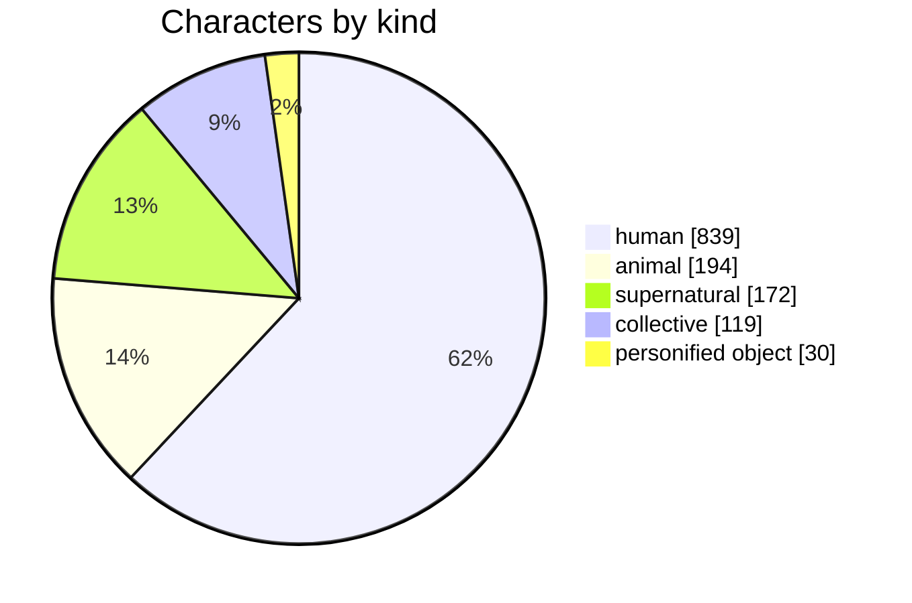
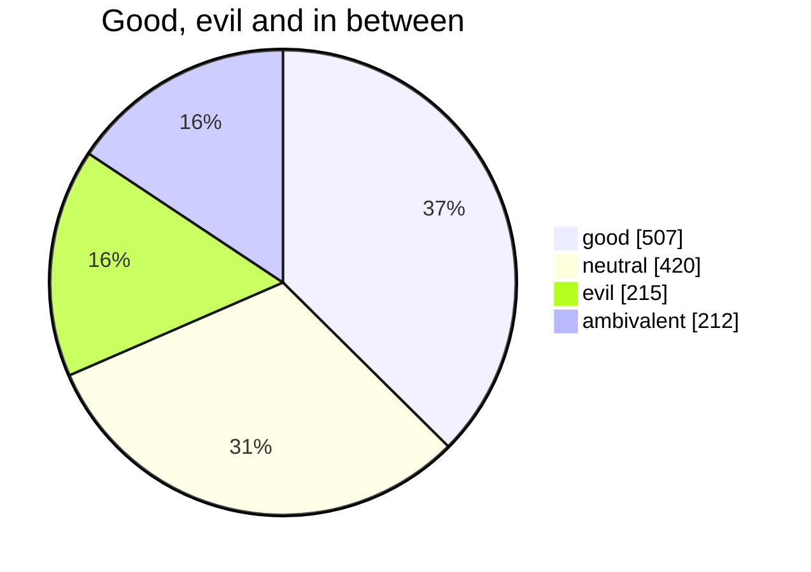
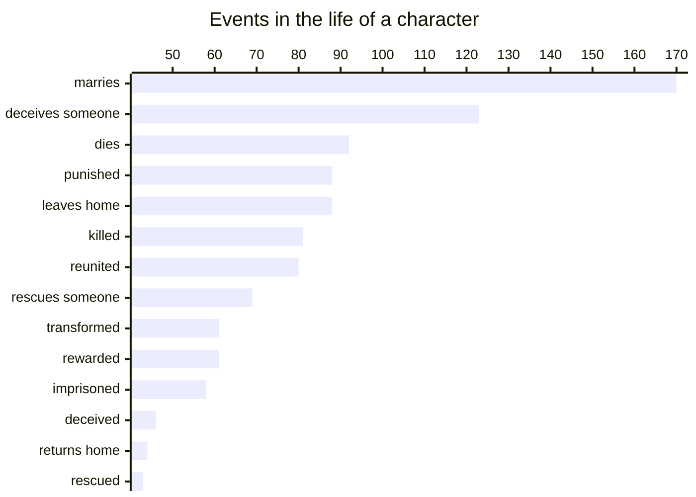
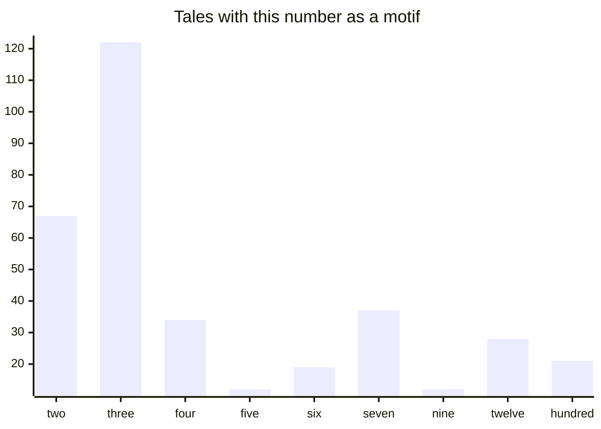
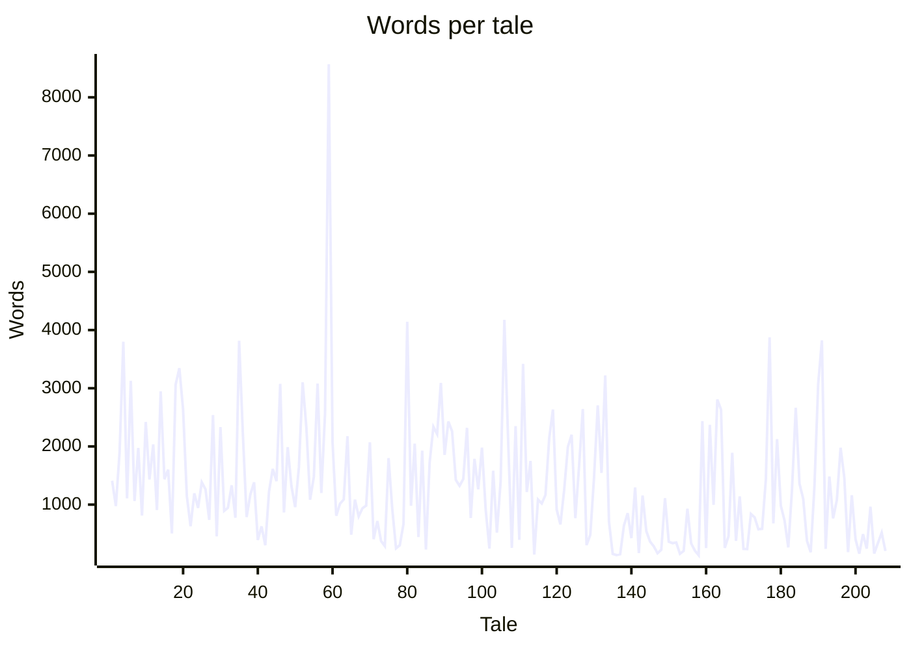

---
tags:
  - grimm
  - index
  - statistics
---

# Statistics

Numbers about the tales and their characters, drawn as charts from `mermaid` code blocks. The character data comes from an AI analysis — see [[Characters]]. Back to the [[Grimm's Household Tales|index]].

## Who Appears

## Good and Evil by Group

Characters per group of tales — the two bars are named series, so they get a legend.

```mermaid
xychart-beta
    title "Good and evil characters"
    x-axis ["Tales of Magic", "Animal Tales", "Jokes and Anecdotes", "Realistic Tales", "Religious Tales"]
    y-axis "Characters"
    bar "Good" [335, 36, 30, 37, 69]
    bar "Evil" [151, 18, 13, 19, 14]
```

## What Happens to Them

| Event | Characters |
|-------|-----------:|
| 💍 marries | 170 |
| 🦊 deceives someone | 123 |
| ⚰️ dies | 92 |
| ⚖️ punished | 88 |
| 🧳 leaves home | 88 |
| 🗡️ killed | 81 |
| 🤝 reunited | 80 |
| 🦸 rescues someone | 69 |
| 🐸 transformed | 61 |
| 🎁 rewarded | 61 |
| 🔒 imprisoned | 58 |
| 🙈 deceived | 46 |
| 🏠 returns home | 44 |
| 🛟 rescued | 43 |
| 🔓 freed | 43 |
| ⚔️ kills someone | 40 |
| 🌲 abandoned | 36 |
| 💰 becomes rich | 32 |
| ✨ set free from a spell | 22 |
| 👑 becomes king | 20 |
| 🌀 cursed | 17 |
| 💤 falls asleep | 16 |
| ☀️ awakens | 14 |
| 👶 born | 12 |
| 👑 becomes queen | 11 |

## Magic Numbers

In how many tales a number turns up as a motif — three brothers, seven ravens, twelve dancing princesses.

## Length of the Tales

Words per tale, in the order of the collection.

| Longest tales | Words | Shortest tales | Words |
|---------------|------:|----------------|------:|
| [[The Two Brothers]] | 8,568 | [[A Riddling Tale]] | 131 |
| [[The Two Travellers]] | 4,176 | [[The Maid of Brakel]] | 133 |
| [[Brother Lustig]] | 4,142 | [[The Wilful Child]] | 142 |
| [[The Goose-Girl at the Well]] | 3,875 | [[Domestic Servants]] | 147 |
| [[The Drummer]] | 3,823 | [[Knoist and his Three Sons]] | 152 |
| [[The Wishing-Table, the Gold-Ass, and the Cudgel in the Sack]] | 3,815 | [[Brides On Their Trial]] | 155 |
| [[The Story of the Youth Who Went Forth to Learn What Fear Was]] | 3,800 | [[The Rose]] | 157 |
| [[The Two Kings' Children]] | 3,418 | [[Our Lady's Little Glass]] | 160 |

## Most Crowded Tales

| Tale | Characters |
|------|-----------:|
| [[The Story of the Youth Who Went Forth to Learn What Fear Was#Who's Who\|The Story of the Youth Who Went Forth to Learn What Fear Was]] | 18 |
| [[The Two Brothers#Who's Who\|The Two Brothers]] | 15 |
| [[The Singing, Springing Lark#Who's Who\|The Singing, Springing Lark]] | 14 |
| [[The Devil With the Three Golden Hairs#Who's Who\|The Devil With the Three Golden Hairs]] | 13 |
| [[Brother Lustig#Who's Who\|Brother Lustig]] | 13 |
| [[Ferdinand the Faithful#Who's Who\|Ferdinand the Faithful]] | 13 |
| [[The Twelve Idle Servants#Who's Who\|The Twelve Idle Servants]] | 13 |
| [[The Valiant Little Tailor#Who's Who\|The Valiant Little Tailor]] | 12 |
| [[Thumbling as Journeyman#Who's Who\|Thumbling as Journeyman]] | 12 |
| [[Hans in Luck#Who's Who\|Hans in Luck]] | 12 |

## Every Character in One Table

[[All Characters]] lists all characters with every field in one very wide and long table — a good test for printing and PDF export.
