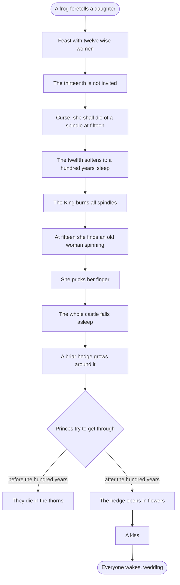
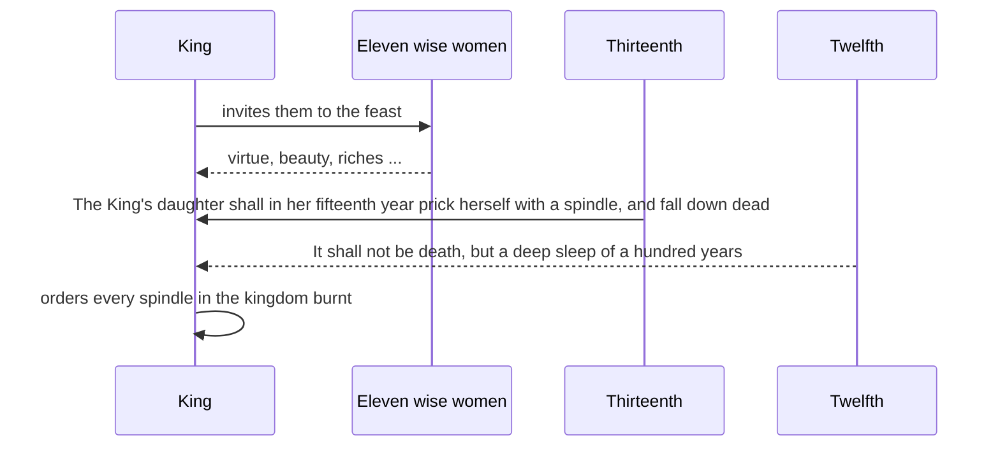
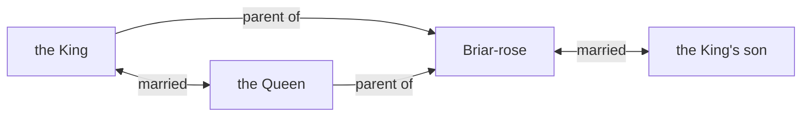

# Briar-Rose

> [!info] Grimm's Household Tales, No. 50
> German title: *Dornröschen* · translated by Margaret Hunt (1884)

![[Briar-Rose.jpg|600]]

> [!abstract] In short
> A childless king and queen receive a daughter after a frog's prophecy. A thirteenth wise woman curses her to die at fifteen, the twelfth softens this to a hundred years' sleep, and the court sleeps with her. A prince passes the thorn hedge, kisses her awake, and they marry.

> [!tip] Diagrams in this tale
> [[#The Story at a Glance|Story flowchart]] · [[#In Their Own Words|Dialogue]] · [[#Family and Friends|Family chart]] · [[#Who's Who|Who's who]]

## The Wish for a Child

A long time ago there were a King and Queen who said every day, “Ah, if only we had a child!” but they never had one. But it happened that once when the Queen was bathing, a frog crept out of the water on to the land, and said to her, “Your wish shall be fulfilled; before a year has gone by, you shall have a daughter.”

What the frog had said came true, and the Queen had a little girl who was so pretty that the King could not contain himself for joy, and ordered a great feast. He invited not only his kindred, friends and acquaintance, but also the Wise Women, in order that they might be kind and well-disposed towards the child. There were thirteen of them in his kingdom, but, as he had only twelve golden plates for them to eat out of, one of them had to be left at home.

## The Feast and the Gifts

The feast was held with all manner of splendour and when it came to an end the Wise Women bestowed their magic gifts upon the baby: one gave virtue, another beauty, a third riches, and so on with everything in the world that one can wish for.

### The Thirteenth Wise Woman's Curse

When eleven of them had made their promises, suddenly the thirteenth came in. She wished to avenge herself for not having been invited, and without greeting, or even looking at any one, she cried with a loud voice, “The King’s daughter shall in her fifteenth year prick herself with a spindle, and fall down dead.” And, without saying a word more, she turned round and left the room.

They were all shocked; but the twelfth, whose good wish still remained unspoken, came forward, and as she could not undo the evil sentence, but only soften it, she said, “It shall not be death, but a deep sleep of a hundred years, into which the princess shall fall.”

The King, who would fain keep his dear child from the misfortune, gave orders that every spindle in the whole kingdom should be burnt. Meanwhile the gifts of the Wise Women were plenteously fulfilled on the young girl, for she was so beautiful, modest, good-natured, and wise, that everyone who saw her was bound to love her.

## The Spindle and the Sleep

It happened that on the very day when she was fifteen years old, the King and Queen were not at home, and the maiden was left in the palace quite alone. So she went round into all sorts of places, looked into rooms and bed-chambers just as she liked, and at last came to an old tower. She climbed up the narrow winding-staircase, and reached a little door. A rusty key was in the lock, and when she turned it the door sprang open, and there in a little room sat an old woman with a spindle, busily spinning her flax.

“Good day, old dame,” said the King’s daughter; “what are you doing there?” “I am spinning,” said the old woman, and nodded her head. “What sort of thing is that, that rattles round so merrily?” said the girl, and she took the spindle and wanted to spin too. But scarcely had she touched the spindle when the magic decree was fulfilled, and she pricked her finger with it.

And, in the very moment when she felt the prick, she fell down upon the bed that stood there, and lay in a deep sleep. And this sleep extended over the whole palace; the King and Queen who had just come home, and had entered the great hall, began to go to sleep, and the whole of the court with them. The horses, too, went to sleep in the stable, the dogs in the yard, the pigeons upon the roof, the flies on the wall; even the fire that was flaming on the hearth became quiet and slept, the roast meat left off frizzling, and the cook, who was just going to pull the hair of the scullery boy, because he had forgotten something, let him go, and went to sleep. And the wind fell, and on the trees before the castle not a leaf moved again.

## The Hedge of Thorns

But round about the castle there began to grow a hedge of thorns, which every year became higher, and at last grew close up round the castle and all over it, so that there was nothing of it to be seen, not even the flag upon the roof. But the story of the beautiful sleeping “Briar-rose,” for so the princess was named, went about the country, so that from time to time kings’ sons came and tried to get through the thorny hedge into the castle.

### The Failed Suitors

But they found it impossible, for the thorns held fast together, as if they had hands, and the youths were caught in them, could not get loose again, and died a miserable death.

After long, long years a King’s son came again to that country, and heard an old man talking about the thorn-hedge, and that a castle was said to stand behind it in which a wonderfully beautiful princess, named Briar-rose, had been asleep for a hundred years; and that the King and Queen and the whole court were asleep likewise. He had heard, too, from his grandfather, that many kings’ sons had already come, and had tried to get through the thorny hedge, but they had remained sticking fast in it, and had died a pitiful death. Then the youth said, “I am not afraid, I will go and see the beautiful Briar-rose.” The good old man might dissuade him as he would, he did not listen to his words.

## The Prince Enters the Castle

But by this time the hundred years had just passed, and the day had come when Briar-rose was to awake again. When the King’s son came near to the thorn-hedge, it was nothing but large and beautiful flowers, which parted from each other of their own accord, and let him pass unhurt, then they closed again behind him like a hedge. In the castle-yard he saw the horses and the spotted hounds lying asleep; on the roof sat the pigeons with their heads under their wings. And when he entered the house, the flies were asleep upon the wall, the cook in the kitchen was still holding out his hand to seize the boy, and the maid was sitting by the black hen which she was going to pluck.

He went on farther, and in the great hall he saw the whole of the court lying asleep, and up by the throne lay the King and Queen.

### The Kiss and the Awakening

Then he went on still farther, and all was so quiet that a breath could be heard, and at last he came to the tower, and opened the door into the little room where Briar-rose was sleeping. There she lay, so beautiful that he could not turn his eyes away; and he stooped down and gave her a kiss. But as soon as he kissed her, Briar-rose opened her eyes and awoke, and looked at him quite sweetly.

Then they went down together, and the King awoke, and the Queen, and the whole court, and looked at each other in great astonishment. And the horses in the court-yard stood up and shook themselves; the hounds jumped up and wagged their tails; the pigeons upon the roof pulled out their heads from under their wings, looked round, and flew into the open country; the flies on the wall crept again; the fire in the kitchen burned up and flickered and cooked the meat; the joint began to turn and frizzle again, and the cook gave the boy such a box on the ear that he screamed, and the maid plucked the fowl ready for the spit.

## The Wedding

And then the marriage of the King’s son with Briar-rose was celebrated with all splendour, and they lived contented to the end of their days.

## The Story at a Glance

## In Their Own Words

## Family and Friends

## Who's Who

| Character | Role | Good or evil | What happens | Fate |
|-----------|------|--------------|--------------|------|
| Briar-rose | protagonist | good | 🌀 💤 ☀️ 💍 | Marries the prince and lives content to the end of her days. |
| the King's son | main | good | 🛟 💍 | Marries Briar-rose. |
| the thirteenth wise woman | antagonist | ==evil== |  | Not further described. |
| the King | supporting | good | 💤 ☀️ | Lives on with the queen and court. |
| the Queen | supporting | good | 💤 ☀️ | Lives on with the king. |
| the twelfth wise woman | supporting | good |  | Not further described. |
| the old woman with the spindle | minor | neutral |  | Not further described. |
| the whole court | minor | neutral | 💤 ☀️ | Wake and resume their duties. |
| the frog | minor | good |  | Not further described. |

%% Generated by an AI model from the text of the tale, not checked by hand. %%

---

← [[The Six Swans]] · [[Enchanted Spouses and Siblings]] · [[Grimm's Household Tales|Index]] · [[Fundevogel (Bird-foundling)]] →
