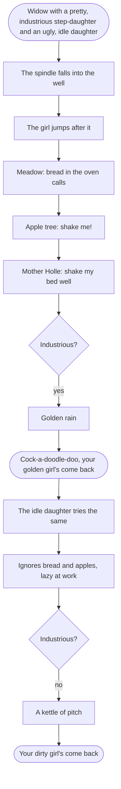
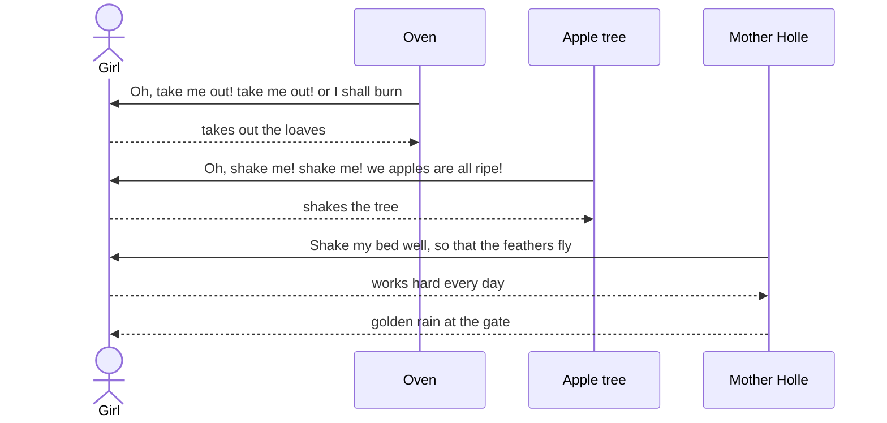
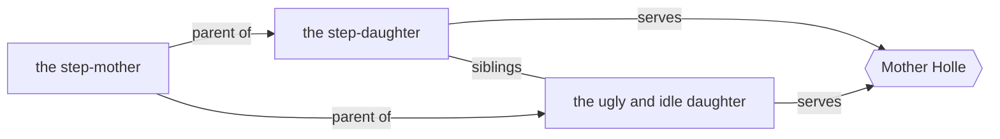

# Mother Holle

> [!info] Grimm's Household Tales, No. 24
> German title: *Frau Holle* · translated by Margaret Hunt (1884)

![[Mother Holle.jpg|600]]

> [!abstract] In short
> A widow favors her idle daughter over her industrious stepdaughter. The stepdaughter is kind to Mother Holle and returns home covered in gold, while the lazy sister is covered in pitch.

> [!tip] Diagrams in this tale
> [[#The Story at a Glance|Story flowchart]] · [[#In Their Own Words|Dialogue]] · [[#Family and Friends|Family chart]] · [[#Who's Who|Who's who]]

## Two Daughters

There was once a widow who had two daughters—one of whom was pretty and industrious, whilst the other was ugly and idle. But she was much fonder of the ugly and idle one, because she was her own daughter; and the other, who was a step-daughter, was obliged to do all the work, and be the Cinderella of the house. Every day the poor girl had to sit by a well, in the highway, and spin and spin till her fingers bled.

## Down the Well

Now it happened that one day the shuttle was marked with her blood, so she dipped it in the well, to wash the mark off; but it dropped out of her hand and fell to the bottom. She began to weep, and ran to her step-mother and told her of the mishap. But she scolded her sharply, and was so merciless as to say, “Since you have let the shuttle fall in, you must fetch it out again.”

So the girl went back to the well, and did not know what to do; and in the sorrow of her heart she jumped into the well to get the shuttle. She lost her senses; and when she awoke and came to herself again, she was in a lovely meadow where the sun was shining and many thousands of flowers were growing. Along this meadow she went, and at last came to a baker’s oven full of bread, and the bread cried out, “Oh, take me out! take me out! or I shall burn; I have been baked a long time!” So she went up to it, and took out all the loaves one after another with the bread-shovel. After that she went on till she came to a tree covered with apples, which called out to her, “Oh, shake me! shake me! we apples are all ripe!” So she shook the tree till the apples fell like rain, and went on shaking till they were all down, and when she had gathered them into a heap, she went on her way.

## Mother Holle's House

At last she came to a little house, out of which an old woman peeped; but she had such large teeth that the girl was frightened, and was about to run away.

But the old woman called out to her, “What are you afraid of, dear child? Stay with me; if you will do all the work in the house properly, you shall be the better for it. Only you must take care to make my bed well, and shake it thoroughly till the feathers fly—for then there is snow on the earth. I am Mother Holle.

### Shaking the Feather Bed

As the old woman spoke so kindly to her, the girl took courage and agreed to enter her service. She attended to everything to the satisfaction of her mistress, and always shook her bed so vigorously that the feathers flew about like snow-flakes. So she had a pleasant life with her; never an angry word; and boiled or roast meat every day.

## Homesickness

She stayed some time with Mother Holle, and then she became sad. At first she did not know what was the matter with her, but found at length that it was home-sickness: although she was many thousand times better off here than at home, still she had a longing to be there. At last she said to the old woman, “I have a longing for home; and however well off I am down here, I cannot stay any longer; I must go up again to my own people.” Mother Holle said, “I am pleased that you long for your home again, and as you have served me so truly, I myself will take you up again.” Thereupon she took her by the hand, and led her to a large door. The door was opened, and just as the maiden was standing beneath the doorway, a heavy shower of golden rain fell, and all the gold remained sticking to her, so that she was completely covered over with it.

## The Golden Rain

“You shall have that because you have been so industrious,” said Mother Holle, and at the same time she gave her back the shuttle which she had let fall into the well. Thereupon the door closed, and the maiden found herself up above upon the earth, not far from her mother’s house.

And as she went into the yard the cock was standing by the well-side, and cried—

“Cock-a-doodle-doo! \
Your golden girl’s come back to you!”

So she went in to her mother, and as she arrived thus covered with gold, she was well received, both by her and her sister.

The girl told all that had happened to her; and as soon as the mother heard how she had come by so much wealth, she was very anxious to obtain the same good luck for the ugly and lazy daughter. She had to seat herself by the well and spin; and in order that her shuttle might be stained with blood, she stuck her hand into a thorn bush and pricked her finger. Then she threw her shuttle into the well, and jumped in after it.

## The Lazy Sister

She came, like the other, to the beautiful meadow and walked along the very same path. When she got to the oven the bread again cried, “Oh, take me out! take me out! or I shall burn; I have been baked a long time!” But the lazy thing answered, “As if I had any wish to make myself dirty?” and on she went. Soon she came to the apple-tree, which cried, “Oh, shake me! shake me! we apples are all ripe!” But she answered, “I like that! one of you might fall on my head,” and so went on.

When she came to Mother Holle’s house she was not afraid, for she had already heard of her big teeth, and she hired herself to her immediately.

## The Pitch

The first day she forced herself to work diligently, and obeyed Mother Holle when she told her to do anything, for she was thinking of all the gold that she would give her. But on the second day she began to be lazy, and on the third day still more so, and then she would not get up in the morning at all. Neither did she make Mother Holle’s bed as she ought, and did not shake it so as to make the feathers fly up. Mother Holle was soon tired of this, and gave her notice to leave. The lazy girl was willing enough to go, and thought that now the golden rain would come. Mother Holle led her also to the great door; but while she was standing beneath it, instead of the gold a big kettleful of pitch was emptied over her. “That is the reward for your service,” said Mother Holle, and shut the door.

So the lazy girl went home; but she was quite covered with pitch, and the cock by the well-side, as soon as he saw her, cried out—

“Cock-a-doodle-doo! \
Your pitchy girl’s come back to you!”

But the pitch stuck fast to her, and could not be got off as long as she lived.

## The Story at a Glance

## In Their Own Words

## Family and Friends

## Who's Who

| Character | Role | Good or evil | What happens | Fate |
|-----------|------|--------------|--------------|------|
| the step-daughter | protagonist | good | 🧳 🎁 🏠 | Returns home covered in gold and is welcomed by her mother and sister. |
| Mother Holle | main | ambivalent |  | Not further mentioned. |
| the step-mother | antagonist | ==evil== |  | Not stated. |
| the ugly and idle daughter | supporting | ==evil== | 🧳 ⚖️ 🏠 | Returns home covered in pitch, which never comes off. |
| the cock | minor | neutral |  | Not stated. |
| the bread | minor | good |  | Not stated. |
| the apple-tree | minor | good |  | Not stated. |

%% Generated by an AI model from the text of the tale, not checked by hand. %%

---

← [[The Mouse, the Bird, and the Sausage]] · [[Superhuman Tasks]] · [[Grimm's Household Tales|Index]] · [[The Seven Ravens]] →
