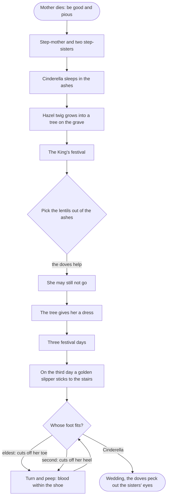
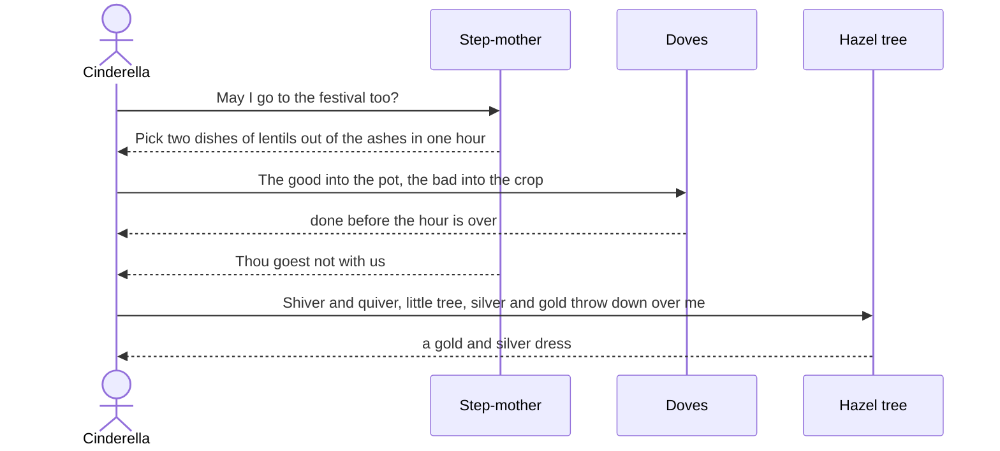
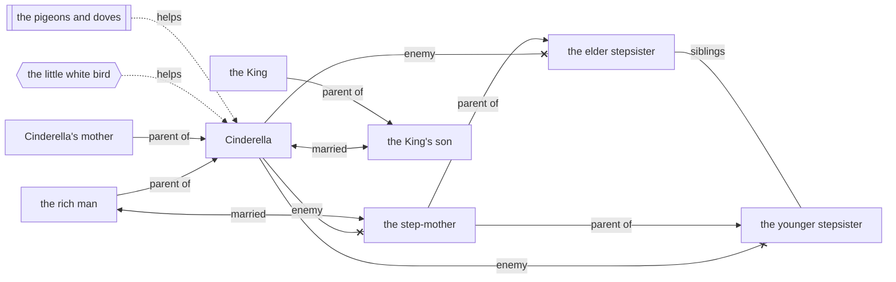

# Cinderella

> [!info] Grimm's Household Tales, No. 21
> German title: *Aschenputtel* · translated by Margaret Hunt (1884)

![[Cinderella.jpg|600]]

> [!abstract] In short
> A dying mother urges her daughter to be good, and a tree grows on her grave. The stepmother and two stepsisters make Cinderella a servant, but a bird on the grave gives her magic dresses for the King's three-day festival. She marries the prince after a golden slipper fits her foot, while her stepsisters maim their feet to fit it and are blinded by pigeons at the wedding.

> [!tip] Diagrams in this tale
> [[#The Story at a Glance|Story flowchart]] · [[#In Their Own Words|Dialogue]] · [[#Family and Friends|Family chart]] · [[#Who's Who|Who's who]]

## The Dead Mother's Grave

The wife of a rich man fell sick, and as she felt that her end was drawing near, she called her only daughter to her bedside and said, “Dear child, be good and pious, and then the good God will always protect thee, and I will look down on thee from heaven and be near thee.” Thereupon she closed her eyes and departed. Every day the maiden went out to her mother’s grave, and wept, and she remained pious and good. When winter came the snow spread a white sheet over the grave, and when the spring sun had drawn it off again, the man had taken another wife.

## The Stepsisters and the Ashes

The woman had brought two daughters into the house with her, who were beautiful and fair of face, but vile and black of heart. Now began a bad time for the poor step-child. “Is the stupid goose to sit in the parlour with us?” said they. “He who wants to eat bread must earn it; out with the kitchen-wench.” They took her pretty clothes away from her, put an old grey bedgown on her, and gave her wooden shoes. “Just look at the proud princess, how decked out she is!” they cried, and laughed, and led her into the kitchen. There she had to do hard work from morning till night, get up before daybreak, carry water, light fires, cook and wash. Besides this, the sisters did her every imaginable injury—they mocked her and emptied her peas and lentils into the ashes, so that she was forced to sit and pick them out again. In the evening when she had worked till she was weary she had no bed to go to, but had to sleep by the fireside in the ashes. And as on that account she always looked dusty and dirty, they called her Cinderella. It happened that the father was once going to the fair, and he asked his two step-daughters what he should bring back for them. “Beautiful dresses,” said one, “Pearls and jewels,” said the second. “And thou, Cinderella,” said he, “what wilt thou have?” “Father, break off for me the first branch which knocks against your hat on your way home.” So he bought beautiful dresses, pearls and jewels for his two step-daughters, and on his way home, as he was riding through a green thicket, a hazel twig brushed against him and knocked off his hat. Then he broke off the branch and took it with him. When he reached home he gave his step-daughters the things which they had wished for, and to Cinderella he gave the branch from the hazel-bush. Cinderella thanked him, went to her mother’s grave and planted the branch on it, and wept so much that the tears fell down on it and watered it. And it grew, however, and became a handsome tree. Thrice a day Cinderella went and sat beneath it, and wept and prayed, and a little white bird always came on the tree, and if Cinderella expressed a wish, the bird threw down to her what she had wished for.

## The Festival

It happened, however, that the King appointed a festival which was to last three days, and to which all the beautiful young girls in the country were invited, in order that his son might choose himself a bride. When the two step-sisters heard that they too were to appear among the number, they were delighted, called Cinderella and said, “Comb our hair for us, brush our shoes and fasten our buckles, for we are going to the festival at the King’s palace.” Cinderella obeyed, but wept, because she too would have liked to go with them to the dance, and begged her step-mother to allow her to do so. “Thou go, Cinderella!” said she; “Thou art dusty and dirty and wouldst go to the festival? Thou hast no clothes and shoes, and yet wouldst dance!” As, however, Cinderella went on asking, the step-mother at last said, “I have emptied a dish of lentils into the ashes for thee, if thou hast picked them out again in two hours, thou shalt go with us.” The maiden went through the back-door into the garden, and called, “You tame pigeons, you turtle-doves, and all you birds beneath the sky, come and help me to pick

“The good into the pot, \
The bad into the crop.”

Then two white pigeons came in by the kitchen-window, and afterwards the turtle-doves, and at last all the birds beneath the sky, came whirring and crowding in, and alighted amongst the ashes. And the pigeons nodded with their heads and began pick, pick, pick, pick, and the rest began also pick, pick, pick, pick, and gathered all the good grains into the dish. Hardly had one hour passed before they had finished, and all flew out again. Then the girl took the dish to her step-mother, and was glad, and believed that now she would be allowed to go with them to the festival. But the step-mother said, “No, Cinderella, thou hast no clothes and thou canst not dance; thou wouldst only be laughed at.” And as Cinderella wept at this, the step-mother said, “If thou canst pick two dishes of lentils out of the ashes for me in one hour, thou shalt go with us.” And she thought to herself, “That she most certainly cannot do.” When the step-mother had emptied the two dishes of lentils amongst the ashes, the maiden went through the back-door into the garden and cried, You tame pigeons, you turtle-doves, and all you birds under heaven, come and help me to pick

“The good into the pot, \
The bad into the crop.”

Then two white pigeons came in by the kitchen-window, and afterwards the turtle-doves, and at length all the birds beneath the sky, came whirring and crowding in, and alighted amongst the ashes. And the doves nodded with their heads and began pick, pick, pick, pick, and the others began also pick, pick, pick, pick, and gathered all the good seeds into the dishes, and before half an hour was over they had already finished, and all flew out again. Then the maiden carried the dishes to the step-mother and was delighted, and believed that she might now go with them to the festival. But the step-mother said, “All this will not help thee; thou goest not with us, for thou hast no clothes and canst not dance; we should be ashamed of thee!” On this she turned her back on Cinderella, and hurried away with her two proud daughters.

### The Hazel Tree

As no one was now at home, Cinderella went to her mother’s grave beneath the hazel-tree, and cried,

“Shiver and quiver, little tree, \
Silver and gold throw down over me.”

Then the bird threw a gold and silver dress down to her, and slippers embroidered with silk and silver. She put on the dress with all speed, and went to the festival. Her step-sisters and the step-mother however did not know her, and thought she must be a foreign princess, for she looked so beautiful in the golden dress. They never once thought of Cinderella, and believed that she was sitting at home in the dirt, picking lentils out of the ashes. The prince went to meet her, took her by the hand and danced with her. He would dance with no other maiden, and never left loose of her hand, and if any one else came to invite her, he said, “This is my partner.”

She danced till it was evening, and then she wanted to go home. But the King’s son said, “I will go with thee and bear thee company,” for he wished to see to whom the beautiful maiden belonged. She escaped from him, however, and sprang into the pigeon-house. The King’s son waited until her father came, and then he told him that the stranger maiden had leapt into the pigeon-house. The old man thought, “Can it be Cinderella?” and they had to bring him an axe and a pickaxe that he might hew the pigeon-house to pieces, but no one was inside it. And when they got home Cinderella lay in her dirty clothes among the ashes, and a dim little oil-lamp was burning on the mantle-piece, for Cinderella had jumped quickly down from the back of the pigeon-house and had run to the little hazel-tree, and there she had taken off her beautiful clothes and laid them on the grave, and the bird had taken them away again, and then she had placed herself in the kitchen amongst the ashes in her grey gown.

### The Second Festival

Next day when the festival began afresh, and her parents and the step-sisters had gone once more, Cinderella went to the hazel-tree and said—

“Shiver and quiver, my little tree, \
Silver and gold throw down over me.”

Then the bird threw down a much more beautiful dress than on the preceding day. And when Cinderella appeared at the festival in this dress, every one was astonished at her beauty. The King’s son had waited until she came, and instantly took her by the hand and danced with no one but her. When others came and invited her, he said, “She is my partner.” When evening came she wished to leave, and the King’s son followed her and wanted to see into which house she went. But she sprang away from him, and into the garden behind the house. Therein stood a beautiful tall tree on which hung the most magnificent pears. She clambered so nimbly between the branches like a squirrel that the King’s son did not know where she was gone. He waited until her father came, and said to him, “The stranger-maiden has escaped from me, and I believe she has climbed up the pear-tree.” The father thought, “Can it be Cinderella?” and had an axe brought and cut the tree down, but no one was on it. And when they got into the kitchen, Cinderella lay there amongst the ashes, as usual, for she had jumped down on the other side of the tree, had taken the beautiful dress to the bird on the little hazel-tree, and put on her grey gown.

### The Third Festival

On the third day, when the parents and sisters had gone away, Cinderella went once more to her mother’s grave and said to the little tree—

“Shiver and quiver, my little tree, \
Silver and gold throw down over me.”

And now the bird threw down to her a dress which was more splendid and magnificent than any she had yet had, and the slippers were golden. And when she went to the festival in the dress, no one knew how to speak for astonishment. The King’s son danced with her only, and if any one invited her to dance, he said, “She is my partner.”

## The Golden Shoe

When evening came, Cinderella wished to leave, and the King’s son was anxious to go with her, but she escaped from him so quickly that he could not follow her. The King’s son had, however, used a strategem, and had caused the whole staircase to be smeared with pitch, and there, when she ran down, had the maiden’s left slipper remained sticking. The King’s son picked it up, and it was small and dainty, and all golden. Next morning, he went with it to the father, and said to him, “No one shall be my wife but she whose foot this golden slipper fits.” Then were the two sisters glad, for they had pretty feet. The eldest went with the shoe into her room and wanted to try it on, and her mother stood by. But she could not get her big toe into it, and the shoe was too small for her. Then her mother gave her a knife and said, “Cut the toe off; when thou art Queen thou wilt have no more need to go on foot.” The maiden cut the toe off, forced the foot into the shoe, swallowed the pain, and went out to the King’s son. Then he took her on his horse as his bride and rode away with her. They were, however, obliged to pass the grave, and there, on the hazel-tree, sat the two pigeons and cried,

“Turn and peep, turn and peep, \
There’s blood within the shoe, \
The shoe it is too small for her, \
The true bride waits for you.”

Then he looked at her foot and saw how the blood was streaming from it. He turned his horse round and took the false bride home again, and said she was not the true one, and that the other sister was to put the shoe on. Then this one went into her chamber and got her toes safely into the shoe, but her heel was too large. So her mother gave her a knife and said, “Cut a bit off thy heel; when thou art Queen thou wilt have no more need to go on foot.” The maiden cut a bit off her heel, forced her foot into the shoe, swallowed the pain, and went out to the King’s son. He took her on his horse as his bride, and rode away with her, but when they passed by the hazel-tree, two little pigeons sat on it and cried,

“Turn and peep, turn and peep, \
There’s blood within the shoe \
The shoe it is too small for her, \
The true bride waits for you.”

He looked down at her foot and saw how the blood was running out of her shoe, and how it had stained her white stocking. Then he turned his horse and took the false bride home again. “This also is not the right one,” said he, “have you no other daughter?” “No,” said the man, “There is still a little stunted kitchen-wench which my late wife left behind her, but she cannot possibly be the bride.” The King’s son said he was to send her up to him; but the mother answered, “Oh, no, she is much too dirty, she cannot show herself!” He absolutely insisted on it, and Cinderella had to be called. She first washed her hands and face clean, and then went and bowed down before the King’s son, who gave her the golden shoe. Then she seated herself on a stool, drew her foot out of the heavy wooden shoe, and put it into the slipper, which fitted like a glove. And when she rose up and the King’s son looked at her face he recognized the beautiful maiden who had danced with him and cried, “That is the true bride!” The step-mother and the two sisters were terrified and became pale with rage; he, however, took Cinderella on his horse and rode away with her. As they passed by the hazel-tree, the two white doves cried—

“Turn and peep, turn and peep, \
No blood is in the shoe, \
The shoe is not too small for her, \
The true bride rides with you,”

and when they had cried that, the two came flying down and placed themselves on Cinderella’s shoulders, one on the right, the other on the left, and remained sitting there.

## Wedding and Punishment

When the wedding with the King’s son had to be celebrated, the two false sisters came and wanted to get into favour with Cinderella and share her good fortune. When the betrothed couple went to church, the elder was at the right side and the younger at the left, and the pigeons pecked out one eye of each of them. Afterwards as they came back, the elder was at the left, and the younger at the right, and then the pigeons pecked out the other eye of each. And thus, for their wickedness and falsehood, they were punished with blindness as long as they lived.

## The Story at a Glance

## In Their Own Words

## Family and Friends

## Who's Who

| Character | Role | Good or evil | What happens | Fate |
|-----------|------|--------------|--------------|------|
| Cinderella | protagonist | good | 💍 🎁 | Marries the King's son; her stepsisters are blinded. |
| the step-mother | antagonist | ==evil== |  | Not individually punished; the story ends with the stepsisters' blindness. |
| the rich man | supporting | ambivalent | 💍 | Not described after the wedding. |
| the elder stepsister | supporting | ==evil== | ⚖️ | Blinded for life by the pigeons. |
| the younger stepsister | supporting | ==evil== | ⚖️ | Blinded for life by the pigeons. |
| the King's son | supporting | good | 💍 | Marries Cinderella. |
| the little white bird | supporting | good |  | Not described after the wedding. |
| the pigeons and doves | supporting | good |  | Perch on Cinderella's shoulders at the end. |
| Cinderella's mother | minor | good | ⚰️ | Dead; her grave is the site of Cinderella's magic. |
| the King | minor | neutral |  | Not described after the festival. |

%% Generated by an AI model from the text of the tale, not checked by hand. %%

---

← [[The Valiant Little Tailor]] · [[Supernatural Helpers]] · [[Grimm's Household Tales|Index]] · [[The Riddle]] →
