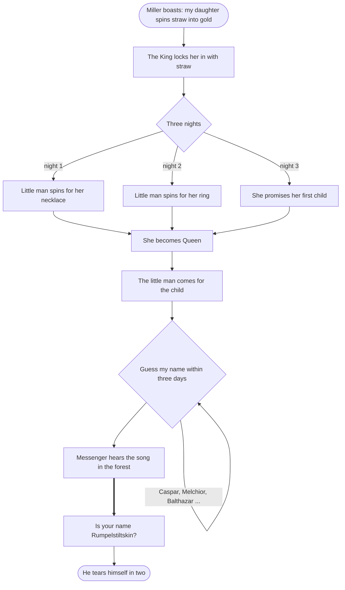
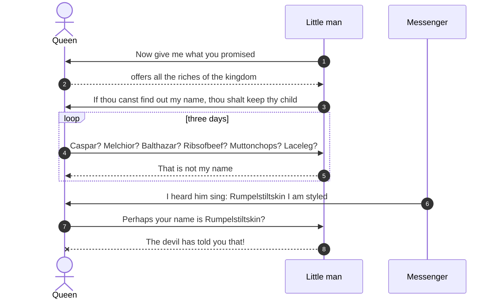
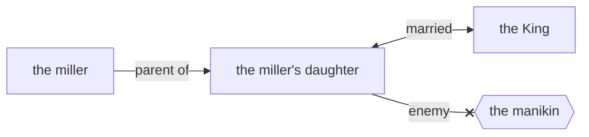

# Rumpelstiltskin

> [!info] Grimm's Household Tales, No. 55
> German title: *Rumpelstilzchen* · translated by Margaret Hunt (1884)

![[Rumpelstiltskin.jpg|600]]

> [!abstract] In short
> A miller boasts that his daughter can spin straw into gold, and a little man spins for her in exchange for her necklace, ring and first child. When she names him, he tears himself apart.

> [!tip] Diagrams in this tale
> [[#The Story at a Glance|Story flowchart]] · [[#In Their Own Words|Dialogue]] · [[#Family and Friends|Family chart]] · [[#Who's Who|Who's who]]

## The Miller's Boast

Once there was a miller who was poor, but who had a beautiful daughter. Now it happened that he had to go and speak to the King, and in order to make himself appear important he said to him, “I have a daughter who can spin straw into gold.” The King said to the miller, “That is an art which pleases me well; if your daughter is as clever as you say, bring her to-morrow to my palace, and I will try what she can do.”

## Three Nights of Spinning

And when the girl was brought to him he took her into a room which was quite full of straw, gave her a spinning-wheel and a reel, and said, “Now set to work, and if by to-morrow morning early you have not spun this straw into gold during the night, you must die.” Thereupon he himself locked up the room, and left her in it alone. So there sat the poor miller’s daughter, and for the life of her could not tell what to do; she had no idea how straw could be spun into gold, and she grew more and more miserable, until at last she began to weep.

### The Necklace

But all at once the door opened, and in came a little man, and said, “Good evening, Mistress Miller; why are you crying so?” “Alas!” answered the girl, “I have to spin straw into gold, and I do not know how to do it.” “What will you give me,” said the manikin, “if I do it for you?” “My necklace,” said the girl. The little man took the necklace, seated himself in front of the wheel, and “whirr, whirr, whirr,” three turns, and the reel was full; then he put another on, and whirr, whirr, whirr, three times round, and the second was full too. And so it went on until the morning, when all the straw was spun, and all the reels were full of gold. By daybreak the King was already there, and when he saw the gold he was astonished and delighted, but his heart became only more greedy. He had the miller’s daughter taken into another room full of straw, which was much larger, and commanded her to spin that also in one night if she valued her life. The girl knew not how to help herself, and was crying, when the door again opened, and the little man appeared, and said, “What will you give me if I spin that straw into gold for you?” “The ring on my finger,” answered the girl. The little man took the ring, again began to turn the wheel, and by morning had spun all the straw into glittering gold.

### The Ring

The King rejoiced beyond measure at the sight, but still he had not gold enough; and he had the miller’s daughter taken into a still larger room full of straw, and said, “You must spin this, too, in the course of this night; but if you succeed, you shall be my wife.” “Even if she be a miller’s daughter,” thought he, “I could not find a richer wife in the whole world.”

### The Promise of the Child

When the girl was alone the manikin came again for the third time, and said, “What will you give me if I spin the straw for you this time also?” “I have nothing left that I could give,” answered the girl. “Then promise me, if you should become Queen, your first child.” “Who knows whether that will ever happen?” thought the miller’s daughter; and, not knowing how else to help herself in this strait, she promised the manikin what he wanted, and for that he once more span the straw into gold.

And when the King came in the morning, and found all as he had wished, he took her in marriage, and the pretty miller’s daughter became a Queen.

## Guessing the Name

A year after, she had a beautiful child, and she never gave a thought to the manikin. But suddenly he came into her room, and said, “Now give me what you promised.” The Queen was horror-struck, and offered the manikin all the riches of the kingdom if he would leave her the child. But the manikin said, “No, something that is living is dearer to me than all the treasures in the world.” Then the Queen began to weep and cry, so that the manikin pitied her. “I will give you three days’ time,” said he, “if by that time you find out my name, then shall you keep your child.”

So the Queen thought the whole night of all the names that she had ever heard, and she sent a messenger over the country to inquire, far and wide, for any other names that there might be. When the manikin came the next day, she began with Caspar, Melchior, Balthazar, and said all the names she knew, one after another; but to every one the little man said, “That is not my name.” On the second day she had inquiries made in the neighborhood as to the names of the people there, and she repeated to the manikin the most uncommon and curious. “Perhaps your name is Shortribs, or Sheepshanks, or Laceleg?” but he always answered, “That is not my name.”

### The Song in the Forest

On the third day the messenger came back again, and said, “I have not been able to find a single new name, but as I came to a high mountain at the end of the forest, where the fox and the hare bid each other good night, there I saw a little house, and before the house a fire was burning, and round about the fire quite a ridiculous little man was jumping: he hopped upon one leg, and shouted—

“To-day I bake, to-morrow brew, \
The next I’ll have the young Queen’s child. \
Ha! glad am I that no one knew \
That Rumpelstiltskin I am styled.”

### The End of the Manikin

You may think how glad the Queen was when she heard the name! And when soon afterwards the little man came in, and asked, “Now, Mistress Queen, what is my name?” at first she said, “Is your name Conrad?” “No.” “Is your name Harry?” “No.”

“Perhaps your name is Rumpelstiltskin?”

“The devil has told you that! the devil has told you that!” cried the little man, and in his anger he plunged his right foot so deep into the earth that his whole leg went in; and then in rage he pulled at his left leg so hard with both hands that he tore himself in two.

## The Story at a Glance

## In Their Own Words

## Family and Friends

## Who's Who

| Character | Role | Good or evil | What happens | Fate |
|-----------|------|--------------|--------------|------|
| the miller's daughter | protagonist | good | 💍 👑 | Becomes queen and keeps her child. |
| the manikin | antagonist | ==evil== | ⚰️ | Tears himself in two. |
| the miller | supporting | ambivalent |  | Not further mentioned. |
| the King | supporting | ambivalent | 💍 | Married to the miller's daughter; not further mentioned. |

%% Generated by an AI model from the text of the tale, not checked by hand. %%

---

← [[The Knapsack, the Hat, and the Horn]] · [[Supernatural Helpers]] · [[Grimm's Household Tales|Index]] · [[Sweetheart Roland]] →
